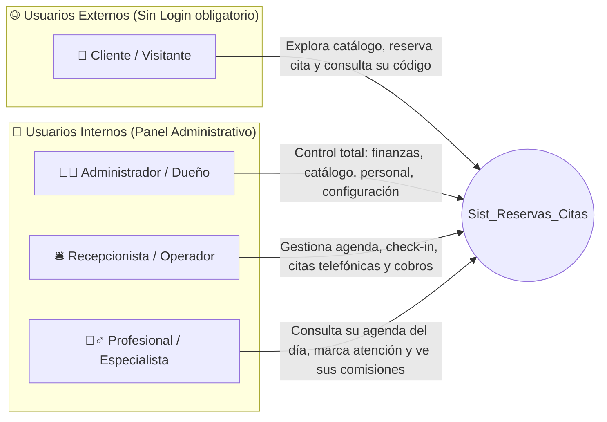

# 01. Especificación de Requisitos de Software (SRS) — ReservaPro

**Proyecto:** Sistema Integral de Reservas Online, Agenda Inteligente y Gestión Comercial (`Sist_Reservas_Citas`)  
**Versión:** 1.0  
**Estándar de Referencia:** IEEE 830 / ISO/IEC/IEEE 29148  

---

## 1. Introducción y Propósito

### 1.1 Propósito del Sistema
Desarrollar una plataforma web integral compuesta por un **Portal Web Público** (orientado a la captación de clientes, exhibición de servicios y agendamiento autónomo 24/7) y un **Panel de Administración (Backoffice / Dashboard)** (orientado a la gestión operativa de citas, control de disponibilidad de profesionales, seguimiento de clientes CRM, caja/pagos y cálculo automático de comisiones).

### 1.2 Alcance Comercial (Adaptabilidad Multi-Nicho)
El sistema está diseñado con parámetros de configuración dinámicos (*White-Label*) para adaptarse sin cambios de código a:
- **Estética y Cuidado Personal:** Barberías, salones de belleza, spas, centros de uñas, estudios de tatuajes.
- **Salud y Bienestar:** Consultorios odontológicos, clínicas médicas, centros de fisioterapia, psicología, veterinarias.
- **Servicios Técnicos y Profesionales:** Talleres automotrices (citas de mantenimiento), estudios fotográficos, asesorías legales o contables.

---

## 2. Actores del Sistema (Perfiles de Usuario)

| Actor | Descripción y Responsabilidades |
|---|---|
| **Cliente / Visitante** | Accede a la página web pública desde su celular o PC. Explora los servicios, precios, promociones y profesionales; reserva una cita en línea seleccionando fecha y hora disponible; y consulta, reprograma o cancela su turno mediante un **Código Único de Reserva** (sin necesidad de crear cuentas complejas). |
| **Profesional / Especialista** | Empleado que presta el servicio (ej. barbero, doctor, estilista, técnico). Inicia sesión para ver únicamente su agenda diaria/semanal, cambiar el estado de la cita a *"En Atención"* o *"Completada"*, agregar notas clínicas/técnicas del cliente y consultar sus comisiones acumuladas. |
| **Recepcionista / Operador** | Encargado de la atención en el local. Registra citas presenciales o telefónicas (*Walk-ins*), confirma reservas pendientes, realiza el *Check-in* del cliente al llegar, registra el cobro en caja y reprograma turnos. |
| **Administrador / Dueño** | Posee acceso total al sistema. Configura los datos e identidad visual del negocio, gestiona el catálogo de servicios y precios, administra los horarios y porcentajes de comisión de los profesionales, visualiza reportes financieros (KPIs) y exporta información. |

---

## 3. Requisitos Funcionales (RF)

### Módulo A: Portal Web Público (Front-Office para Clientes)

| Código | Nombre del Requisito | Descripción Detallada | Prioridad |
|---|---|---|---|
| **RF-01** | Landing Page Comercial Dinámica | Mostrar información del negocio (nombre, eslogan, horarios de atención, dirección, botón de WhatsApp, galería y reseñas destacadas) cargada desde la configuración del panel. | Alta |
| **RF-02** | Catálogo de Servicios Filtrable | Permitir a los visitantes explorar los servicios agrupados por categoría, mostrando nombre, descripción, duración estimada (en minutos) y precio. | Alta |
| **RF-03** | Selección de Profesional | Permitir elegir un profesional específico que realice el servicio seleccionado o elegir la opción *"Cualquier profesional disponible"*. | Alta |
| **RF-04** | Motor de Disponibilidad en Tiempo Real | Calcular y mostrar únicamente los bloques de horario libres (`slots`) según el día elegido, la duración del servicio, el horario laboral del profesional, sus descansos y las citas ya agendadas. | Crítica |
| **RF-05** | Registro Rápido de Reserva (Wizard) | Guiar al cliente en un asistente paso a paso (1. Servicio → 2. Profesional → 3. Fecha/Hora → 4. Datos de contacto: Nombre, Teléfono/WhatsApp, Email opcional y Notas) para confirmar la cita. | Crítica |
| **RF-06** | Generación de Comprobante y Código de Seguimiento | Al confirmar la reserva, generar un código alfanumérico único (ej. `RES-8492`), mostrar el ticket resumen en pantalla (descargable/imprimible) y botón de confirmación directa por WhatsApp. | Alta |
| **RF-07** | Portal de Consulta y Autogestión de Cita | Permitir al cliente ingresar su **Código de Reserva** o número de teléfono en la web para ver el estado actual de su cita (`Pendiente`, `Confirmada`, `Completada`, `Cancelada`) y permitirle cancelarla o solicitar reprogramación si está dentro del tiempo permitido. | Alta |
| **RF-08** | Calificación y Reseña Post-Servicio | Permitir que un cliente con una cita en estado `Completada` califique su experiencia (1 a 5 estrellas) y deje un comentario utilizando su código de reserva. | Media |

---

### Módulo B: Panel Administrativo (Back-Office / Dashboard)

| Código | Nombre del Requisito | Descripción Detallada | Prioridad |
|---|---|---|---|
| **RF-09** | Autenticación y Control de Roles (RBAC) | Inicio de sesión seguro con usuario/correo y contraseña. Restricción de vistas y acciones según el rol (`ADMIN`, `RECEPCION`, `PROFESIONAL`). | Crítica |
| **RF-10** | Dashboard de Métricas y KPIs en Tiempo Real | Mostrar tarjetas de resumen del día y del mes: Ingresos totales, cantidad de citas del día, citas pendientes de confirmar, tasa de asistencia vs. cancelación, gráfico de ingresos por día y ranking de servicios/profesionales más solicitados. | Alta |
| **RF-11** | Calendario / Agenda Interactiva | Vista de agenda por día, semana o lista filtrable por profesional y por estado de cita. Permite ver rápidamente huecos libres y citas ocupadas con código de colores. | Crítica |
| **RF-12** | Creación Manual de Citas (Walk-in / Teléfono) | Permitir al administrador o recepcionista agendar una cita directamente desde el panel para clientes que llaman o llegan directamente al local. | Alta |
| **RF-13** | Gestión del Ciclo de Vida de la Cita | Cambiar el estado de una cita con un clic: `Pendiente` → `Confirmada` → `En Atención` → `Completada`, o marcar como `Cancelada` / `No Asistió (No-Show)`. | Crítica |
| **RF-14** | Gestión de Catálogo de Servicios y Categorías | CRUD completo (Crear, Leer, Actualizar, Activar/Desactivar) de categorías y servicios, definiendo precio, duración en minutos, color identificador y descripción. | Alta |
| **RF-15** | Gestión de Profesionales y Especialidades | CRUD de profesionales con foto/avatar, cargo/especialidad, porcentaje de comisión por servicio (ej. 40%, 50%), servicios que está habilitado a realizar y estado (Activo/Inactivo). | Alta |
| **RF-16** | Configuración de Horarios y Bloqueos | Configurar los días laborables, hora de apertura/cierre, horario de almuerzo y bloqueos puntuales (vacaciones, permisos médicos o feriados) por profesional o para todo el local. | Alta |
| **RF-17** | Directorio CRM y Ficha Histórica de Clientes | Base de datos automática de clientes con buscador, historial de todas sus visitas, total gastado (LTV), notas de preferencias/alergias/observaciones y etiqueta de cliente frecuente o alerta por inasistencias. | Alta |
| **RF-18** | Módulo de Caja, Cobros y Liquidación de Comisiones | Al marcar una cita como `Completada`, registrar el pago (Efectivo, Transferencia, Tarjeta, QR), aplicar descuentos opcionales y calcular automáticamente cuánto dinero corresponde al negocio y cuánto de comisión al profesional. | Alta |
| **RF-19** | Moderación de Reseñas | Permitir al administrador aprobar o rechazar las reseñas enviadas por los clientes antes de que aparezcan públicamente en la página web. | Media |
| **RF-20** | Configuración White-Label del Negocio | Panel para personalizar el nombre comercial, rubro, moneda, logo, color primario de la marca, teléfono de WhatsApp, dirección y políticas de cancelación. | Alta |

---

## 4. Requisitos No Funcionales (RNF)

1. **RNF-01 (Usabilidad y Diseño Responsivo Mobile-First):** La página web pública debe ser 100% adaptable a teléfonos móviles (de donde proviene más del 80% de las reservas de clientes), mientras que el Panel Administrativo debe ser fluido tanto en computadoras de escritorio (recepción) como en tablets/móviles.
2. **RNF-02 (Rendimiento en Cálculo de Horarios):** El motor de disponibilidad debe calcular y devolver los horarios libres de una fecha en menos de **300 ms**, evitando bloqueos de interfaz.
3. **RNF-03 (Integridad y Prevención de Doble Reserva):** El sistema debe validar a nivel lógico y de base de datos que dos clientes no puedan reservar al mismo profesional en un rango de hora que se solape.
4. **RNF-04 (Seguridad):** Contraseñas encriptadas, validación de datos en cliente y servidor, protección de rutas del panel administrativo mediante sesiones/tokens (JWT) y sanitización contra inyección de código.
5. **RNF-05 (Facilidad de Despliegue y Venta):** El proyecto debe poder instalarse rápidamente en cualquier servidor local o en la nube con datos semilla (*Seed Data*) pre-cargados para hacer demostraciones inmediatas a clientes potenciales.

---

## 5. Reglas de Negocio (RN)

- **RN-01 (No Solapamiento de Citas):** Una nueva cita para el profesional $P$ con hora de inicio $T_{ini}$ y hora de fin $T_{fin} = T_{ini} + \text{Duración del Servicio}$ solo es válida si no existe ninguna cita activa (`Pendiente`, `Confirmada` o `En Atención`) para el profesional $P$ en la misma fecha cuyo intervalo $(C_{ini}, C_{fin})$ cumpla:
  $$T_{ini} < C_{fin} \quad \text{y} \quad T_{fin} > C_{ini}$$
- **RN-02 (Respeto de Horario Laboral y Descansos):** Ninguna cita puede iniciar antes de la hora de entrada del profesional, terminar después de su hora de salida, ni cruzarse con un bloqueo de horario (ej. hora de almuerzo).
- **RN-03 (Ventana Mínima de Cancelación):** Un cliente solo puede cancelar o reprogramar su cita desde la web pública si faltan al menos $X$ horas (configurable por el negocio, por defecto 2 horas) para el inicio del turno.
- **RN-04 (Cálculo Automático de Comisión):** Cuando una cita pasa a estado `Completada` y se registra su pago por un monto neto $M$, la comisión del profesional se calcula automáticamente como:
  $$\text{Comisión} = M \times \left(\frac{\% \text{Comisión del Profesional}}{100}\right)$$
  Y la utilidad bruta para el local es $M - \text{Comisión}$.
- **RN-05 (Trazabilidad de Clientes por Teléfono):** Si un cliente reserva ingresando un número de teléfono que ya existe en la base de datos, el sistema vincula automáticamente la nueva cita a su ficha histórica (CRM) sin duplicar el cliente, incrementando su contador de visitas.
