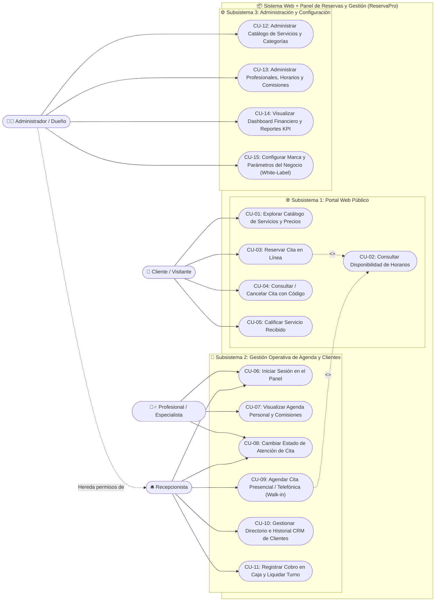
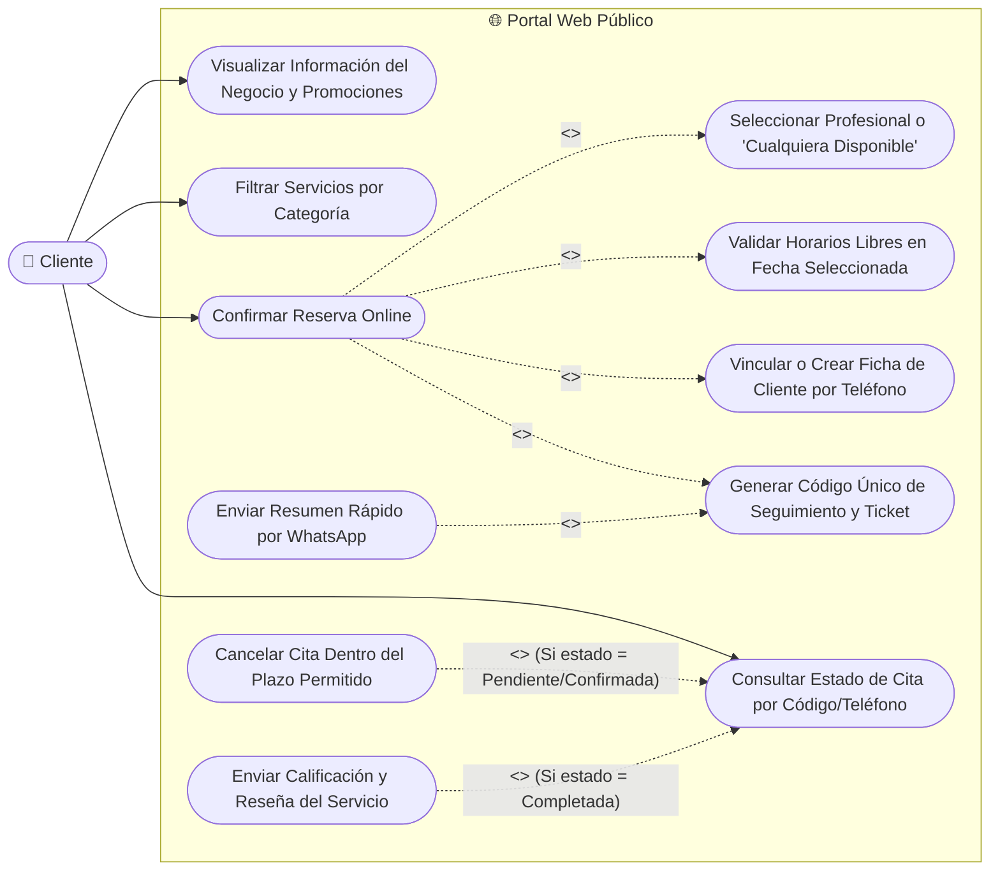
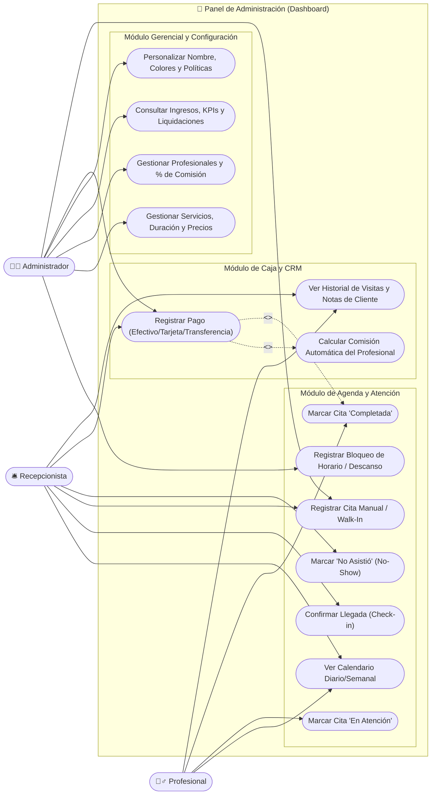

# 02. Diagramas y Especificación de Casos de Uso (UML)

Este documento contiene los **Diagramas de Casos de Uso** divididos por actores y subsistemas, seguidos de las **Fichas Técnicas de Casos de Uso** con precondiciones, flujo normal, flujos alternativos y postcondiciones.

---

## 1. Diagrama General de Casos de Uso del Sistema

---

## 2. Diagrama de Casos de Uso — Subsistema Portal Web Público (Cliente)

Detalla todas las interacciones que realiza el cliente en la página web pública, incluyendo relaciones `<<include>>` y `<<extend>>`.

---

## 3. Diagrama de Casos de Uso — Subsistema Panel Administrativo (Roles Internos)

Detalla cómo interactúan el **Especialista**, el **Recepcionista** y el **Administrador** dentro del Panel de Control (Dashboard).

---

## 4. Especificación Detallada de Casos de Uso (Fichas Técnicas)

### Ficha CU-03: Reservar Cita en Línea (Portal Web)

| Campo | Descripción |
|---|---|
| **ID y Nombre** | **CU-03: Reservar Cita en Línea** |
| **Actor Principal** | Cliente / Visitante Web |
| **Objetivo** | Permitir al cliente agendar una cita seleccionando servicio, profesional, fecha y hora libre, obteniendo un código único de reserva. |
| **Precondiciones** | 1. Debe existir al menos un servicio activo y un profesional activo asignado a ese servicio. 2. El profesional debe tener horarios disponibles en la fecha seleccionada. |
| **Flujo Principal (Camino Feliz)** | 1. El cliente selecciona el botón *"Agendar Cita"* en la página web o elige un servicio del catálogo. 2. El sistema muestra la lista de profesionales que realizan dicho servicio (incluyendo la opción *"Cualquiera disponible"*). 3. El cliente selecciona el profesional y elige una fecha en el calendario. 4. El sistema ejecuta el motor de disponibilidad (`CU-02`) y muestra los bloques de hora libres (ej. `09:00`, `09:45`, `10:30`). 5. El cliente selecciona la hora deseada e ingresa su Nombre Completo, Teléfono/WhatsApp, Correo (opcional) y Notas adicionales. 6. El sistema verifica que el horario siga disponible (control de concurrencia), registra o actualiza al cliente en el CRM por su teléfono, guarda la cita en estado `CONFIRMADA` (o `PENDIENTE` según configuración) y genera un código único (ej. `RES-4821`). 7. El sistema muestra en pantalla el comprobante con el código, resumen de la cita y botón para enviar confirmación por WhatsApp. |
| **Flujos Alternativos** | **FA-1 (Sin horarios disponibles en la fecha):** En el paso 4, si el día está lleno o es día libre, el sistema informa *"No hay turnos disponibles en esta fecha"* y sugiere pasar al día siguiente. **FA-2 (Horario tomado en el último segundo):** En el paso 6, si otro usuario reservó ese mismo bloque segundos antes, el sistema alerta al usuario y refresca los horarios libres sin borrar sus datos personales. |
| **Postcondiciones** | La cita queda almacenada en el sistema, el horario queda bloqueado para evitar dobles reservas y la cita aparece inmediatamente en el Dashboard Administrativo. |

---

### Ficha CU-04: Consultar o Cancelar Cita con Código de Seguimiento

| Campo | Descripción |
|---|---|
| **ID y Nombre** | **CU-04: Consultar / Cancelar Cita con Código** |
| **Actor Principal** | Cliente |
| **Objetivo** | Permitir al cliente verificar el estado de su reserva o cancelarla sin tener que llamar al negocio. |
| **Precondiciones** | El cliente cuenta con su Código de Reserva (ej. `RES-4821`) o el número de teléfono con el que agendó. |
| **Flujo Principal** | 1. El cliente accede a la sección *"Consultar mi Cita"* en la página web. 2. Ingresa su Código de Reserva (o su teléfono). 3. El sistema busca la cita y muestra una tarjeta detallada con: Estado actual (`Pendiente`, `Confirmada`, `En Atención`, `Completada`, `Cancelada`), Servicio, Profesional asignado, Fecha, Hora y Precio. 4. Si el cliente desea cancelar, presiona *"Cancelar Reserva"* e indica opcionalmente el motivo. 5. El sistema valida que falten más de $X$ horas (según política del negocio) y cambia el estado a `CANCELADA`, liberando inmediatamente el horario en el calendario. |
| **Flujos Alternativos** | **FA-1 (Código no encontrado):** El sistema muestra un mensaje indicando que verifique el código o número telefónico. **FA-2 (Fuera del límite de tiempo para cancelar):** Si falta menos del tiempo mínimo permitido (ej. menos de 2 horas), el sistema deshabilita el botón de cancelación automática y muestra un enlace directo al WhatsApp de recepción. |
| **Postcondiciones** | Si se cancela, el bloque horario vuelve a estar disponible en la web pública para otros clientes. |

---

### Ficha CU-11: Registrar Cobro en Caja y Liquidar Turno (Panel Admin)

| Campo | Descripción |
|---|---|
| **ID y Nombre** | **CU-11: Registrar Cobro en Caja y Liquidar Turno** |
| **Actor Principal** | Recepcionista o Administrador |
| **Objetivo** | Finalizar la atención de una cita, registrar el método de pago y calcular automáticamente la comisión del profesional y la ganancia del negocio. |
| **Precondiciones** | El usuario ha iniciado sesión con rol `ADMIN` o `RECEPCION` y existe una cita en estado `CONFIRMADA` o `EN_ATENCION`. |
| **Flujo Principal** | 1. El operador selecciona la cita en la agenda o lista del día y hace clic en *"Finalizar y Cobrar"*. 2. El sistema precarga el precio del servicio (permitiendo ajustar el monto o aplicar un descuento/servicio extra si corresponde). 3. El operador selecciona el método de pago (`Efectivo`, `Transferencia / QR`, `Tarjeta`). 4. El sistema consulta el porcentaje de comisión configurado para el profesional que atendió (ej. 45%) y calcula:    - `Monto Comisión Profesional`    - `Ingreso Neto del Negocio` 5. El sistema cambia el estado de la cita a `COMPLETADA`, registra la transacción en Caja, suma una visita completada al historial del cliente (CRM) y actualiza las métricas del Dashboard en tiempo real. |
| **Postcondiciones** | La cita queda cerrada, el ingreso se refleja en el arqueo de caja del día y la comisión se suma a la cuenta de liquidación del profesional. |

---

### Ficha CU-13: Administrar Profesionales, Horarios y Comisiones

| Campo | Descripción |
|---|---|
| **ID y Nombre** | **CU-13: Administrar Profesionales, Horarios y Comisiones** |
| **Actor Principal** | Administrador / Dueño |
| **Objetivo** | Configurar el equipo de trabajo, los servicios que realiza cada uno, su horario semanal y su porcentaje de ganancia. |
| **Precondiciones** | El usuario tiene sesión activa con rol `ADMIN`. |
| **Flujo Principal** | 1. El Administrador accede al módulo *"Equipo / Profesionales"*. 2. Crea o edita un profesional ingresando: Nombre, Especialidad/Cargo, Teléfono, Foto/Avatar, Color en calendario y `% de Comisión` (0% a 100%). 3. Selecciona mediante casillas de verificación qué servicios del catálogo está capacitado para realizar. 4. Define su jornada laboral (días activos de Lunes a Domingo, hora de inicio, hora de fin y rango de descanso/almuerzo). 5. Guarda los cambios. |
| **Postcondiciones** | El motor de disponibilidad web empieza a ofrecer inmediatamente los horarios de ese profesional únicamente para los servicios que tiene asignados. |
