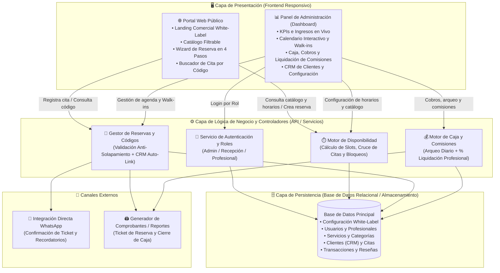
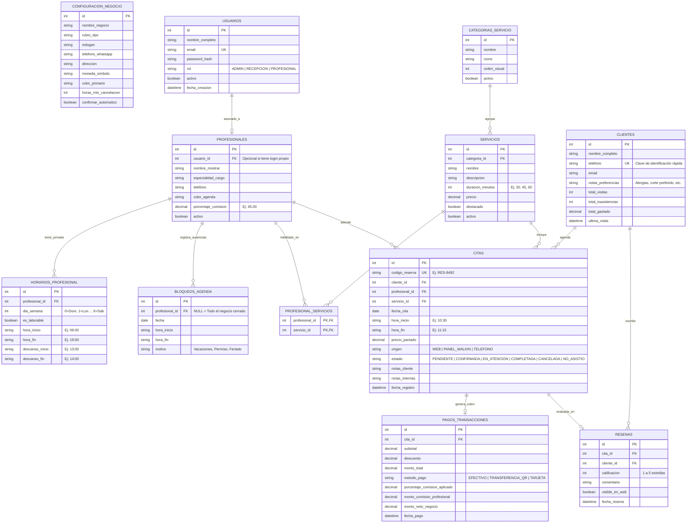

# 03. Arquitectura del Sistema y Diseño de Base de Datos (ERD)

Este documento describe la arquitectura tecnológica en capas del sistema **ReservaPro (`Sist_Reservas_Citas`)**, el **Diagrama Entidad-Relación (ERD)** y el **Diccionario de Datos** completo.

---

## 1. Diagrama de Arquitectura de Software (En Capas)

El sistema separa claramente el **Portal Web Público** del **Panel Administrativo**, ambos consumiendo una capa de lógica de negocio centralizada que garantiza que ninguna reserva se duplique y que los cambios en el panel se reflejen al instante en la web pública.

---

## 2. Diagrama Entidad-Relación (ERD — Base de Datos)

---

## 3. Diccionario de Datos Principal

### 3.1 Tabla `CITAS` (Núcleo Operativo)
Almacena tanto las reservas creadas desde la página web como los turnos agendados manualmente en recepción.

| Columna | Tipo | Restricción | Descripción |
|---|---|---|---|
| `id` | `INTEGER` | `PK, AUTO_INCREMENT` | Identificador único interno de la cita. |
| `codigo_reserva` | `VARCHAR(15)` | `UNIQUE, NOT NULL` | Código público de seguimiento para el cliente (ej. `RES-4920`). |
| `cliente_id` | `INTEGER` | `FK -> CLIENTES(id)` | Cliente titular del turno. |
| `profesional_id` | `INTEGER` | `FK -> PROFESIONALES(id)` | Especialista asignado a la atención. |
| `servicio_id` | `INTEGER` | `FK -> SERVICIOS(id)` | Servicio contratado. |
| `fecha_cita` | `DATE` | `NOT NULL, INDEX` | Fecha programada del turno (`YYYY-MM-DD`). |
| `hora_inicio` | `VARCHAR(5)` | `NOT NULL` | Hora de inicio en formato 24h (`HH:MM`). |
| `hora_fin` | `VARCHAR(5)` | `NOT NULL` | Hora calculada sumando `duracion_minutos` del servicio a `hora_inicio`. |
| `precio_pactado` | `DECIMAL(10,2)` | `NOT NULL` | Precio congelado al momento de agendar (protege ante cambios futuros de tarifa). |
| `origen` | `ENUM` | `NOT NULL` | Canal de creación: `WEB`, `PANEL_WALKIN`, `TELEFONO`. |
| `estado` | `ENUM` | `NOT NULL` | Estado actual: `PENDIENTE`, `CONFIRMADA`, `EN_ATENCION`, `COMPLETADA`, `CANCELADA`, `NO_ASISTIO`. |
| `notas_cliente` | `TEXT` | `NULL` | Comentario dejado por el cliente al reservar. |
| `notas_internas` | `TEXT` | `NULL` | Observaciones técnicas/clínicas privadas del profesional o recepción. |

---

### 3.2 Tabla `PAGOS_TRANSACCIONES` (Núcleo Financiero y Comisiones)
Garantiza la transparencia financiera entre el dueño del negocio y sus profesionales.

| Columna | Tipo | Restricción | Descripción |
|---|---|---|---|
| `id` | `INTEGER` | `PK, AUTO_INCREMENT` | Identificador único del cobro. |
| `cita_id` | `INTEGER` | `FK -> CITAS(id), UNIQUE` | Cita que origina el ingreso. |
| `subtotal` | `DECIMAL(10,2)` | `NOT NULL` | Valor base del servicio más adicionales. |
| `descuento` | `DECIMAL(10,2)` | `DEFAULT 0.00` | Descuento promocional aplicado en caja. |
| `monto_total` | `DECIMAL(10,2)` | `NOT NULL` | Monto final cobrado al cliente (`subtotal - descuento`). |
| `metodo_pago` | `ENUM` | `NOT NULL` | `EFECTIVO`, `TRANSFERENCIA_QR`, `TARJETA`. |
| `porcentaje_comision_aplicado` | `DECIMAL(5,2)` | `NOT NULL` | Porcentaje vigente del profesional en el momento del cobro. |
| `monto_comision_profesional` | `DECIMAL(10,2)` | `NOT NULL` | Dinero que le corresponde al profesional por ese servicio. |
| `monto_neto_negocio` | `DECIMAL(10,2)` | `NOT NULL` | Ganancia neta que queda en caja para la empresa. |
| `fecha_pago` | `DATETIME` | `NOT NULL` | Fecha y hora exacta del cierre del cobro. |
