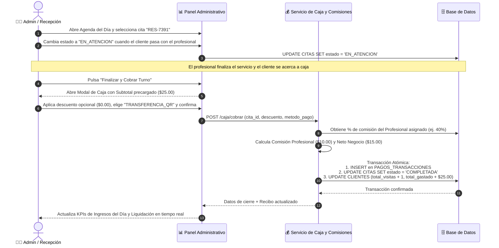
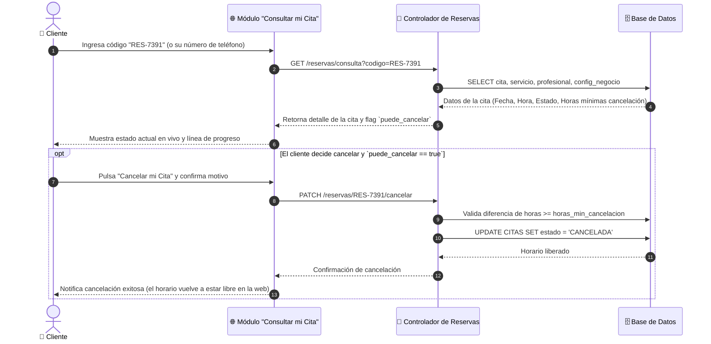
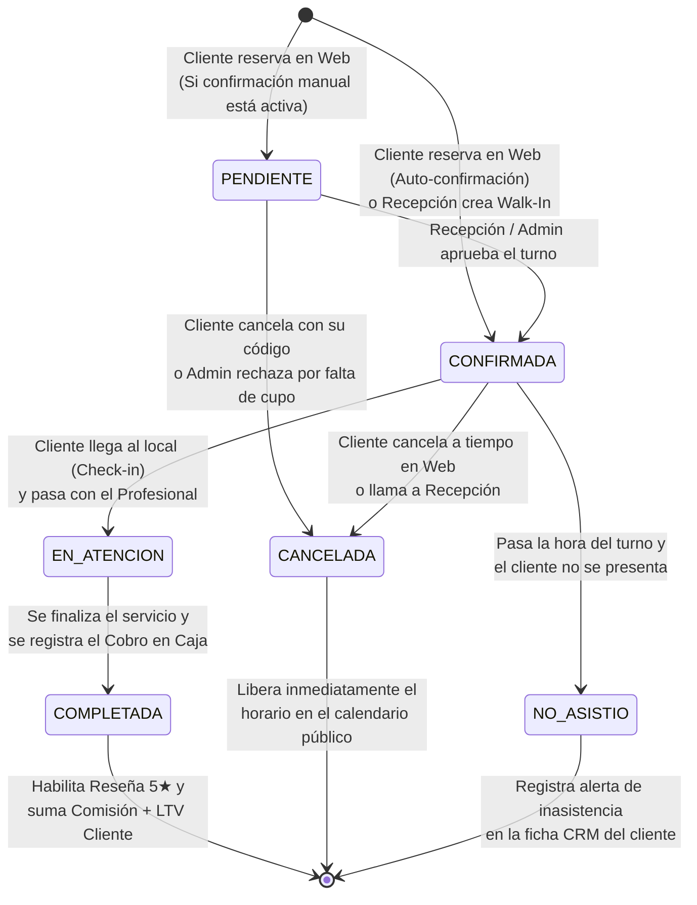
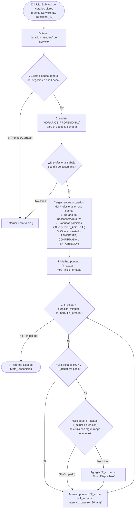

# 04. Diagramas de Secuencia, Estados y Flujo de Procesos

Este documento modela el comportamiento dinámico del sistema **ReservaPro (`Sist_Reservas_Citas`)** mediante diagramas UML de **Secuencia**, **Máquina de Estados** y **Flujo Algorítmico**.

---

## 1. Diagrama de Secuencia 01: Proceso de Reserva Online (Portal Web)

Representa la interacción cronológica desde que el cliente selecciona un servicio en la web hasta que obtiene su **Código Único de Reserva (`RES-XXXX`)** y la cita impacta en el Panel Administrativo.

```mermaid
sequenceDiagram
    autonumber
    actor Cliente as 👤 Cliente (Web)
    participant UI as 🌐 Frontend Portal Web
    participant SlotEngine as ⏱️ Motor de Disponibilidad
    participant BookingAPI as 📅 Controlador de Reservas
    participant DB as 🗄️ Base de Datos

    Cliente->>UI: Selecciona Servicio (ej. Corte + Barba, 45 min) y Profesional
    Cliente->>UI: Elige Fecha en el Calendario (ej. 25/10/2026)
    UI->>SlotEngine: GET /disponibilidad?servicio=2&prof=1&fecha=2026-10-25
    SlotEngine->>DB: Consulta horario laboral, descansos, bloqueos y citas activas del día
    DB-->>SlotEngine: Retorna jornada (09:00-19:00) y citas ocupadas
    SlotEngine->>SlotEngine: Calcula intervalos libres donde caben 45 min sin solaparse
    SlotEngine-->>UI: Lista de Slots Libres ["09:00", "09:45", "11:30", "15:00"...]
    UI-->>Cliente: Muestra botones de horarios disponibles

    Cliente->>UI: Elige "11:30", ingresa Nombre, Teléfono y Notas, y pulsa "Confirmar"
    UI->>BookingAPI: POST /reservas (datos_cliente, servicio, prof, fecha, "11:30")
    BookingAPI->>DB: Verifica que el bloque 11:30 - 12:15 siga libre (Control de concurrencia)

    alt El horario sigue disponible
        BookingAPI->>DB: Busca cliente por Teléfono (Si no existe lo crea; si existe vincula ID)
        BookingAPI->>BookingAPI: Genera código único (ej. "RES-7391")
        BookingAPI->>DB: INSERT en tabla CITAS (estado = CONFIRMADA, origen = WEB)
        DB-->>BookingAPI: Confirmación de registro exitoso
        BookingAPI-->>UI: HTTP 201 Created (Ticket + Código "RES-7391")
        UI-->>Cliente: Muestra Comprobante Digital + Botón WhatsApp
    else El horario fue tomado segundos antes
        DB-->>BookingAPI: Conflicto de horario detectado
        BookingAPI-->>UI: HTTP 409 Conflict ("Horario recién ocupado, elige otro turno")
        UI-->>Cliente: Refresca lista de horarios libres manteniendo sus datos
    end
```

---

## 2. Diagrama de Secuencia 02: Atención, Cobro en Caja y Cálculo de Comisión (Panel Admin)

Muestra cómo trabajan en equipo la Recepción/Administrador y el sistema financiero cuando el cliente asiste al negocio y paga su servicio.



---

## 3. Diagrama de Secuencia 03: Consulta y Cancelación por Código de Seguimiento



---

## 4. Diagrama de Máquina de Estados: Ciclo de Vida de una Cita

Modela todos los estados posibles por los que atraviesa una cita desde su creación hasta su cierre definitivo, incluyendo quién dispara cada transición.



---

## 5. Diagrama de Flujo Algorítmico: Motor Inteligente de Disponibilidad (`SlotEngine`)

Este diagrama detalla la lógica exacta que utilizaremos al programar el cálculo de horarios libres para evitar cruces de turnos:


