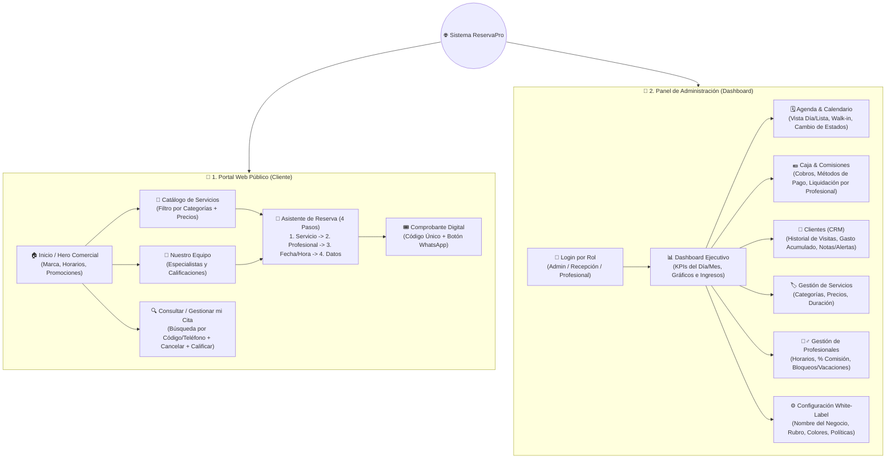

# 05. Arquitectura UI/UX, Mapa de Módulos y Estrategia Comercial

Este documento define el **Mapa de Navegación**, la **Estructura de Pantallas (Wireframes)**, los **Contratos de Datos (Endpoints)** y el **Manual Comercial** para vender el sistema a distintos rubros de negocio.

---

## 1. Mapa de Navegación del Sistema (Sitemap)



---

## 2. Diseño Estructural de Pantallas Clave (Wireframes)

### 2.1 Vista: Portal Web Público + Asistente de Reserva

```text
+-----------------------------------------------------------------------------------+
| [LOGO]  NOMBRE DEL NEGOCIO (White-Label)     [Servicios] [Equipo] [🔍 Mi Cita] [🔐 Panel] |
+-----------------------------------------------------------------------------------+
|  ⭐ Reserva tu turno online en menos de 1 minuto — Sin llamadas ni esperas        |
|  [ 📅 AGENDAR CITA AHORA ]                     [ 🔍 CONSULTAR CÓDIGO DE CITA ]    |
+-----------------------------------------------------------------------------------+
|  ASISTENTE INTERACTIVO DE RESERVA (PASO A PASO)                                   |
|  (1. Servicio) =====> (2. Especialista) =====> (3. Fecha y Hora) =====> (4. Datos)|
|  +-----------------------------------------------------------------------------+  |
|  | Categorías: [Todos] [Cortes & Estilo] [Barba & Spa] [Paquetes VIP]          |  |
|  |                                                                             |  |
|  |  +-----------------------------------+  +--------------------------------+  |  |
|  |  | ✂️ Corte Clásico + Lavado         |  | 🧔 Perfilado de Barba con Vapor|  |  |
|  |  | ⏱️ 45 min  |  💲 $15.00           |  | ⏱️ 30 min  |  💲 $10.00        |  |  |
|  |  | [ Seleccionar -> ]                |  | [ Seleccionar -> ]             |  |  |
|  |  +-----------------------------------+  +--------------------------------+  |  |
|  +-----------------------------------------------------------------------------+  |
+-----------------------------------------------------------------------------------+
```

### 2.2 Vista: Panel de Administración (Dashboard + Agenda Operativa)

```text
+-----------------------------------------------------------------------------------+
| 📊 PANEL ReservaPro | Rubro: Barbería / Clínica    👤 Admin (Dueño)  [🌐 Ver Web] |
+------------------+----------------------------------------------------------------+
| MENÚ LATERAL     |  KPIs DEL DÍA (HOY)                                            |
|                  |  +---------------+ +---------------+ +---------------+ +-----+ |
| • 📊 Dashboard   |  | 📅 Citas Hoy  | | ⏳ En Espera   | | 💵 Caja Hoy   | | ⭐  | |
| • 🗓️ Agenda Hoy  |  |      14       | |       3       | |   $ 320.00    | | 4.9 | |
| • 💵 Caja/Pagos  |  +---------------+ +---------------+ +---------------+ +-----+ |
| • 📇 Clientes CRM|                                                                |
| • 🏷️ Servicios   |  AGENDA OPERATIVA EN TIEMPO REAL          [+ Nueva Cita Manual]|
| • 💇‍♂️ Equipo      |  Filtro: [Todos los Profesionales v] [Fecha: Hoy v]            |
| • ⭐ Reseñas     |  +-----------------------------------------------------------+ |
| • ⚙️ Ajustes     |  | Hora  | Código   | Cliente      | Servicio | Prof. |Acción| |
|                  |  |-------|----------|--------------|----------|-------|------| |
|                  |  | 09:00 | RES-1042 | Carlos Gómez | Corte VIP| Mateo |[Cobro]| |
|                  |  | 10:00 | RES-1045 | Luis Pineda  | Barba Spa| Sofía |[Atend]| |
|                  |  | 11:30 | RES-1049 | Andrés Silva | Limpieza | Mateo |[Conf.]| |
|                  |  +-----------------------------------------------------------+ |
+------------------+----------------------------------------------------------------+
```

---

## 3. Especificación de Servicios / Endpoints (API Interna)

| Método | Ruta / Acción | Rol Requerido | Descripción |
|---|---|---|---|
| `GET` | `/api/public/config` | Público | Obtiene nombre, colores, rubro, catálogo activo, profesionales y reseñas aprobadas. |
| `GET` | `/api/public/slots` | Público | Calcula los bloques horarios disponibles según `fecha`, `servicio_id` y `profesional_id`. |
| `POST` | `/api/public/reservas` | Público | Valida disponibilidad, registra o vincula al cliente y crea la cita retornando `codigo_reserva`. |
| `GET` | `/api/public/reservas/:codigo` | Público | Consulta estado en vivo de una cita mediante su código único o teléfono. |
| `PATCH` | `/api/public/reservas/:codigo/cancelar` | Público | Cancela la cita si cumple la ventana horaria y libera el turno. |
| `POST` | `/api/public/resenas` | Público | Registra calificación de 1 a 5 estrellas para una cita completada. |
| `POST` | `/api/auth/login` | Público | Autentica a usuarios internos (`ADMIN`, `RECEPCION`, `PROFESIONAL`). |
| `GET` | `/api/admin/dashboard` | Interno | Retorna métricas KPI, ingresos por método de pago, citas por estado y comisiones. |
| `POST` | `/api/admin/citas` | Admin/Recep | Crea una cita manual (*Walk-in* o telefónica) desde recepción. |
| `PATCH` | `/api/admin/citas/:id/estado` | Interno | Cambia el estado de la cita (`CONFIRMADA`, `EN_ATENCION`, `NO_ASISTIO`, `CANCELADA`). |
| `POST` | `/api/admin/caja/cobrar` | Admin/Recep | Registra el pago de la cita, calcula comisión del profesional y cierra en `COMPLETADA`. |
| `CRUD` | `/api/admin/servicios` | Admin | Creación, edición y activación/pausa de servicios y categorías. |
| `CRUD` | `/api/admin/profesionales` | Admin | Gestión de especialistas, porcentajes de comisión, horarios y bloqueos. |
| `PUT` | `/api/admin/configuracion` | Admin | Actualiza marca White-Label (colores, logo, rubro, moneda, WhatsApp). |

---

## 4. Estrategia Comercial (Guía para Vender el Sistema)

Dado que el objetivo principal de este desarrollo es **comercializarlo a negocios reales**, el sistema incluirá un **Selector Rápido de Rubro (Modo Demo Comercial)** en el Panel de Configuración para que cuando visites a un cliente puedas mostrarle el sistema adaptado a su negocio en 5 segundos:

| Rubro / Nicho | Cómo se adapta el sistema (Plantilla) | Argumento clave de venta para el dueño |
|---|---|---|
| **1. Barberías y Salones de Belleza** | Servicios de corte, barba, tintura, manicure; cálculo automático del 40%-50% de comisión por barbero/estilista. | *"Deja de perder clientes cuando estás cortando el pelo y no puedes contestar WhatsApp. Además, el sistema te calcula exactamente cuánto pagarle a cada barbero el sábado por la noche."* |
| **2. Consultorios Dentales / Médicos / Estética** | Consultas, limpiezas, ortodoncia, sesiones láser; ficha CRM con notas clínicas/alergias y control de inasistencias. | *"Tus pacientes agendan desde su celular viendo los horarios libres de cada doctor, y en recepción llevas el historial clínico-administrativo y control de caja al día."* |
| **3. Veterinarias y Peluquerías Caninas** | Baño medicado, corte canino, consulta general, vacunación; notas de nombre de la mascota y raza. | *"Organiza los turnos de baño y peluquería sin saturar las jaulas del local y permite que el dueño vea en la web cuando su mascota ya está en atención o lista."* |
| **4. Talleres Mecánicos / Lavaderos Detailing** | Cambio de aceite, alineación, lavado premium detailing; bahías de trabajo o técnicos como profesionales. | *"Recibe vehículos por cita programada y permite al cliente consultar en vivo con su código si su vehículo está en espera, en servicio o listo para retirar."* |
