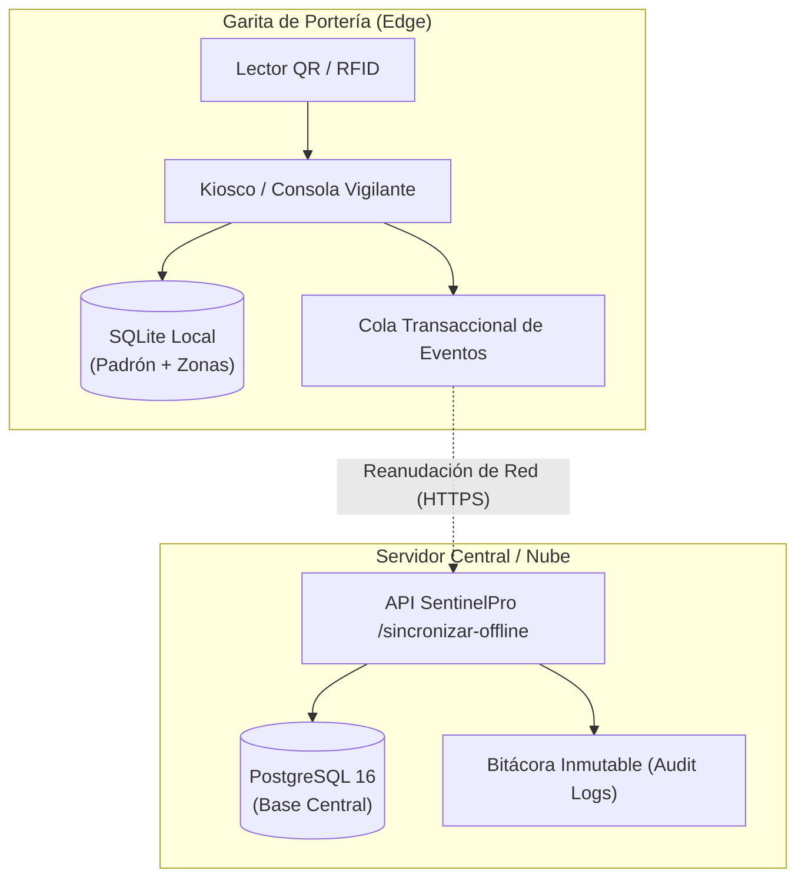
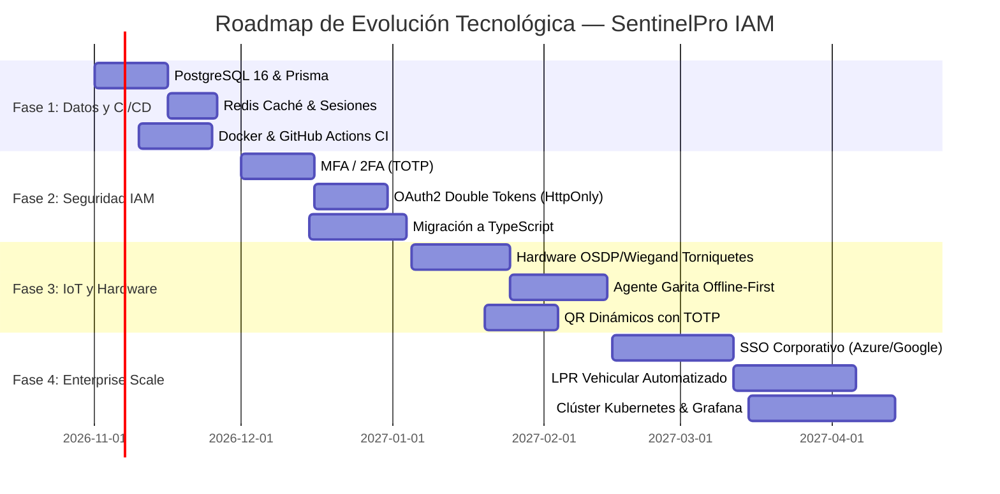

# 🚀 Plan Estratégico de Evolución Tecnológica, Recomendaciones de Ingeniería y Roadmap
## SentinelPro Access & IAM — Suite Empresarial de Control de Acceso y Gestión de Identidades

> **Documento de Arquitectura y Buenas Prácticas de Ingeniería**  
> **Versión del Sistema Auditado:** SentinelPro IAM v2.0  
> **Fecha de Emisión:** Octubre 2026  
> **Estado de Validación Automatizada:** ✅ 15 de 15 pruebas aprobadas (100% de éxito en `scripts/qa-test-suite.js`)  
> **Documento Word Generado:** [`Documentacion_Plan_Estrategico_Y_Recomendaciones.docx`](../Documentacion_Plan_Estrategico_Y_Recomendaciones.docx)

---

## 📑 Tabla de Contenidos
1. [Diagnóstico del Estado Actual y Evaluación de Madurez](#1-diagnóstico-del-estado-actual-y-evaluación-de-madurez)
2. [Eje 1: Base de Datos y Persistencia de Alto Rendimiento](#2-eje-1-base-de-datos-y-persistencia-de-alto-rendimiento)
3. [Eje 2: Fortalecimiento de la Seguridad Criptográfica e IAM](#3-eje-2-fortalecimiento-de-la-seguridad-criptográfica-e-iam)
4. [Eje 3: Integración de Hardware Físico en Portería (IoT & Edge)](#4-eje-3-integración-de-hardware-físico-en-portería-iot--edge)
5. [Eje 4: Arquitectura Garita Offline-First (Resiliencia en Borde)](#5-eje-4-arquitectura-garita-offline-first-resiliencia-en-borde)
6. [Eje 5: Modernización del Backend y Arquitectura por Eventos](#6-eje-5-modernización-del-backend-y-arquitectura-por-eventos)
7. [Eje 6: Experiencia de Usuario (UI/UX) y Modo Kiosco Táctil Industrial](#7-eje-6-experiencia-de-usuario-uiux-y-modo-kiosco-táctil-industrial)
8. [Eje 7: DevOps, Contenedores, CI/CD y Observabilidad en la Nube](#8-eje-7-devops-contenedores-cicd-y-observabilidad-en-la-nube)
9. [Cronograma de Ejecución (Roadmap 30 - 60 - 90 - 180 Días)](#9-cronograma-de-ejecución-roadmap-30---60---90---180-días)
10. [Matriz de Riesgos Técnicos y Contingencias](#10-matriz-de-riesgos-técnicos-y-contingencias)
11. [Checklist de Acciones Inmediatas](#11-checklist-de-acciones-inmediatas)

---

## 1. Diagnóstico del Estado Actual y Evaluación de Madurez

SentinelPro IAM resuelve de forma nativa los requerimientos fundamentales del control de acceso físico empresarial:
- **Control de Acceso y Garita:** Fichaje ágil de entradas y salidas de trabajadores mediante DNI o credencial RFID (`EMP-XXX`), validación de estado de la credencial (`ACTIVO`, `SUSPENDIDO`), detección automática de duplicidad de entradas (`ALREADY_INSIDE`), cálculo de jornada y horas laboradas, y monitoreo de aforo en vivo.
- **Motor de Autorización Híbrido:** Roles predefinidos (RBAC) combinados con excepciones granulares por usuario (`ALLOW`, `DENY`, `INHERIT`) evaluadas con precedencia estricta en el Backend.
- **Seguridad Criptográfica:** Contraseñas hasheadas con algoritmo `scrypt` (sal aleatoria de 16 bytes y clave derivada de 64 bytes) y tokens de sesión firmados mediante HMAC-SHA256 con comparación en tiempo constante (`crypto.timingSafeEqual`).
- **Control de Visitantes y Contratistas:** Asignación de gafetes temporales, anfitrión interno y control de salida.
- **Auditoría Inmutable:** Registro detallado de eventos de autenticación, autorizaciones, bloqueos y accesos denegados.

### Matriz FODA Técnica

| Dimensión | Factores Técnicos Observados |
| :--- | :--- |
| **Fortalezas (F)** | • Cero dependencias externas en tiempo de ejecución (máxima portabilidad y bajo riesgo en la cadena de suministro).<br>• Criptografía estándar de la industria (scrypt + HMAC-SHA256).<br>• Pruebas automatizadas con cobertura del 100% de escenarios críticos. |
| **Oportunidades (O)** | • Conexión directa con torniquetes y talanqueras físicas mediante protocolos industriales (OSDP/Wiegand).<br>• Comercialización como solución SaaS multitenant para parques industriales y edificios de oficinas.<br>• Integración con ERPs y sistemas de nómina (SAP, Workday, Siigo) vía Webhooks. |
| **Debilidades (D)** | • Persistencia actual en archivo plano JSON (`database/db.json`) con I/O síncrono que puede generar cuellos de botella en alta concurrencia.<br>• Falta de tokens de refresco (Refresh Tokens) en cookies seguras HttpOnly.<br>• Cuentas administrativas sin segundo factor de autenticación (MFA/TOTP).<br>• Inoperatividad de garita si se interrumpe la red local (falta de modo Offline-First). |
| **Amenazas (A)** | • Congestión en garita durante cambios de turno masivos (500+ personas en 15 minutos).<br>• Suplantación física por captura de pantalla si los códigos QR son estáticos.<br>• Riesgo de corrupción si el servidor sufre un apagón repentino durante la escritura de `db.json`. |

---

## 2. Eje 1: Base de Datos y Persistencia de Alto Rendimiento

### 2.1. Transición a PostgreSQL 16 con Connection Pooling
Actualmente, `database/db.json` emula la base de datos. Para soportar cientos de marcaciones concurrentes por segundo, se debe activar el esquema relacional ya preparado en [`database/schema.sql`](../database/schema.sql):
- **Motor Recomendado:** PostgreSQL 16.
- **Mapeador / Capa de Acceso:** Prisma ORM o Kysely para máxima seguridad de tipos y control de consultas.
- **Agrupamiento de Conexiones:** `pg-pool` configurado con 20-50 conexiones activas y timeout de conexión de 2,000 ms.
- **Transacciones ACID:** Bloqueo a nivel de fila (`SELECT ... FOR UPDATE`) al registrar entradas/salidas para evitar condiciones de carrera entre dos torniquetes simultáneos.

### 2.2. Particionamiento Mensual de Tablas Masivas
Las tablas `registros_acceso` y `audit_logs` crecerán a millones de registros por año. Se recomienda particionamiento declarativo por rango de fechas:
```sql
CREATE TABLE registros_acceso (
    id BIGSERIAL,
    trabajador_id INT NOT NULL,
    zona_id INT NOT NULL,
    tipo_movimiento VARCHAR(20) NOT NULL,
    created_at TIMESTAMP WITH TIME ZONE DEFAULT CURRENT_TIMESTAMP,
    PRIMARY KEY (id, created_at)
) PARTITION BY RANGE (created_at);

-- Partición ejemplo Octubre 2026
CREATE TABLE registros_acceso_2026_10 PARTITION OF registros_acceso
    FOR VALUES FROM ('2026-10-01 00:00:00+00') TO ('2026-11-01 00:00:00+00');
```

### 2.3. Caché Ultrarrápido con Redis 7
- **Lista Blanca de Acceso:** Mantener en memoria Redis la clave `credencial:{codigo}` con el estado (`AUTORIZADO` o `SUSPENDIDO`) y lista de zonas permitidas. Esto permite que el lector del torniquete decida en **menos de 2 milisegundos**.
- **Gestión de Sesiones y Blacklist:** Almacenar tokens revocados con tiempo de vida (TTL) para invalidación instantánea.

---

## 3. Eje 2: Fortalecimiento de la Seguridad Criptográfica e IAM

### 3.1. Autenticación Multifactor (MFA / 2FA - RFC 6238)
- Generación de secreto TOTP de 160 bits (formato Base32).
- Códigos numéricos de 6 dígitos con ventana de tolerancia de ±30 segundos.
- Códigos de recuperación (Backup Codes) de un solo uso encriptados con hash en base de datos.
- Obligatorio para roles `SUPER_ADMIN`, `ADMIN_SEGURIDAD` y `SUPERVISOR_RRHH`.

### 3.2. Arquitectura de Doble Token (OAuth2 / OIDC)
Reemplazar el token único en `localStorage` por una arquitectura defensiva en profundidad:
1. **Access Token (JWT):** Duración máxima de 15 minutos. Contiene únicamente `sub` (ID de usuario), `rol` y firmas de permisos.
2. **Refresh Token Rotativo:** Duración de 7 días. Transmitido exclusivamente a través de cookies HTTP con las banderas:
   - `HttpOnly`: Inaccesible desde JavaScript (mitigación de robo de sesión por XSS).
   - `Secure`: Transmisión únicamente sobre HTTPS.
   - `SameSite=Strict`: Inmune a ataques de falsificación de petición en sitios cruzados (CSRF).
   - Al renovar, el Refresh Token anterior se destruye y se emite uno nuevo (Refresh Token Rotation).

### 3.3. Integración con SSO Corporativo
- Integración con **Microsoft Entra ID (Azure AD)**, **Google Workspace** y **Okta** vía OpenID Connect.
- Aprovisionamiento y desaprovisionamiento automatizado de cuentas de trabajadores mediante estándar **SCIM 2.0**.

### 3.4. Rate Limiting y Protección contra Fuerza Bruta
- Algoritmo Token Bucket en memoria/Redis: máximo 5 intentos fallidos de inicio de sesión o marcación en 60 segundos por IP/usuario.
- Respuestas con cabeceras estándar: `RateLimit-Limit`, `RateLimit-Remaining`, `RateLimit-Reset`.

---

## 4. Eje 3: Integración de Hardware Físico en Portería (IoT & Edge)

| Dispositivo Físico | Protocolo / Interfaz | Lógica de Implementación |
| :--- | :--- | :--- |
| **Torniquetes / Molinetes** | OSDP v2 sobre RS-485 / Relé IP | Disparo de pulso de apertura de 500 ms tras autorización en Backend. Monitoreo del sensor de paso. |
| **Tarjetas RFID / NFC** | MIFARE DESFire EV2/EV3 | Cifrado AES-128 con lectura de sector seguro; previene clonación de tarjetas convencionales de 125 kHz / 13.56 MHz. |
| **Kiosco de Garita** | WebSockets / HID / WebUSB | Lector óptico láser de alto rendimiento capaz de escanear cédulas físicas y pantallas móviles en <300 ms. |
| **Talanqueras Vehiculares** | Modbus TCP / Relé IP | Apertura automática para camiones y vehículos de reparto autorizados tras validar placa o tag RFID vehicular. |
| **Cámaras LPR / ANPR** | ONVIF Profile S / API REST | Reconocimiento automático de matrícula vehicular con OCR neuronal; vinculación inmediata con la entrada del conductor. |

### Códigos QR Dinámicos con TOTP (Antifraude)
Para evitar que los operarios compartan capturas de pantalla de sus credenciales:
- El código QR en la app del trabajador se regenera cada 30 segundos.
- La carga útil del QR está firmada criptográficamente con la clave del trabajador y la marca de tiempo actual.
- Si el lector escanea un QR con antigüedad mayor a 45 segundos o con firma inválida, el acceso es rechazado inmediatamente.

---

## 5. Eje 4: Arquitectura Garita Offline-First (Resiliencia en Borde)

### 5.1. Problema Operativo
Si se interrumpe la fibra óptica o el switch central de la planta industrial, la portería no puede paralizarse: cientos de trabajadores deben continuar entrando y saliendo a tiempo.

### 5.2. Solución: Agente Edge con SQLite Local


1. **Detección Automática de Red (Heartbeat):** El terminal consulta cada 5 segundos al servidor central. Si falla 3 veces consecutivas, conmuta a `MODO OFFLINE`.
2. **Autorización Local:** El kiosco consulta la réplica local en SQLite para autorizar o denegar el acceso.
3. **Cola de Sincronización:** Cada marcación se firma localmente con UUID v4 y timestamp de alta precisión.
4. **Sincronización Transaccional:** Cuando vuelve la conexión, el terminal transmite los eventos en lotes; el servidor central los procesa en orden temporal, actualiza el aforo y marca el registro como `MODO_OFFLINE_RECUPERADO`.

---

## 6. Eje 5: Modernización del Backend y Arquitectura por Eventos

### 6.1. Adopción de TypeScript y Clean Architecture
Evolucionar la base de código actual hacia módulos tipados:
- `src/domain/`: Entidades de negocio puras (`Trabajador`, `RegistroAcceso`, `PoliticaAcceso`, `Usuario`).
- `src/application/`: Casos de uso (`FicharEntradaUseCase`, `OtorgarPermisoIndividualUseCase`).
- `src/infrastructure/`: Adaptadores de base de datos (PostgreSQL/Redis), controladores HTTP y clientes de hardware.

### 6.2. Event-Driven Architecture (EDA) con BullMQ
Separar la respuesta instantánea en portería del procesamiento secundario:
- Al registrar el paso de un trabajador, el backend responde en **<30 ms** liberando el torniquete.
- Se publica el evento `AccesoConcedidoEvent` en una cola Redis (BullMQ).
- Workers secundarios en segundo plano procesan:
  - Notificación push o WhatsApp al supervisor si el trabajador llegó con tardanza.
  - Alerta a seguridad patrimonial si el aforo de la zona supera el 95%.
  - Cálculo de acumulación de horas para la pre-nómina.

---

## 7. Eje 6: Experiencia de Usuario (UI/UX) y Modo Kiosco Táctil Industrial

1. **Modo Kiosco Industrial Full-Screen:**
   - Interfaz simplificada con botones táctiles de al menos 80x80 píxeles.
   - Paleta de color optimizada para visualización bajo luz solar directa o en garitas con iluminación tenue.
2. **Retroalimentación Acústica de Alta Claridad:**
   - Tonos de audio diferenciados generados con Web Audio API:
     - Tono ascendente nítido (880 Hz): **Acceso Permitido / Marcación Exitosa**.
     - Doble tono grave descendente (220 Hz): **Acceso Denegado / Credencial No Autorizada**.
   - Permite que el vigilante escuche el resultado a varios metros sin desviar la mirada del flujo peatonal.
3. **PWA (Progressive Web App) para Patrullaje:**
   - Aplicación instalable en tablets Android/iPad para vigilantes de seguridad en rondines por patios y almacenes.
   - Soporte para cámara del dispositivo como lector de credenciales.
4. **Accesibilidad WCAG 2.1 AA:**
   - Compatibilidad completa con lectores de pantalla, navegación por teclado y contraste de color superior a 4.5:1.

---

## 8. Eje 7: DevOps, Contenedores, CI/CD y Observabilidad en la Nube

### 8.1. Contenedorización Multi-Etapa (Dockerfile)
```dockerfile
# Etapa 1: Build y dependencias
FROM node:20-alpine AS builder
WORKDIR /app
COPY package*.json ./
RUN npm ci --only=production

# Etapa 2: Imagen final liviana
FROM node:20-alpine AS runner
WORKDIR /app
ENV NODE_ENV=production
COPY --from=builder /app/node_modules ./node_modules
COPY . .
USER node
EXPOSE 3450
CMD ["node", "server/server.js"]
```

### 8.2. Orquestación Local con Docker Compose
Archivo `docker-compose.yml` que provisione:
- `app`: Servidor SentinelPro IAM.
- `postgres`: Base de datos PostgreSQL 16 con volumen persistente.
- `redis`: Servidor de caché y sesiones.
- `nginx`: Reverse Proxy con certificados SSL Let's Encrypt y compresión gzip/brotli.

### 8.3. Pipeline CI/CD en GitHub Actions
Archivo `.github/workflows/ci.yml`:
1. **Linter y Formato:** Ejecución de ESLint y Prettier.
2. **Pruebas Automatizadas:** Ejecución de `node scripts/qa-test-suite.js` (los 15 casos deben aprobar).
3. **Análisis de Seguridad (SAST):** Escaneo con Semgrep y `npm audit`.
4. **Build de Contenedores:** Construcción de imagen Docker y escaneo con Trivy.

### 8.4. Observabilidad y Métricas
- **Logger Estructurado (Pino):** Logs en formato JSON con `trace_id`, `user_id` y `ip` para ingesta en Grafana Loki o Elasticsearch.
- **Métricas Prometheus:** Exponer `/metrics` con contadores de marcaciones por minuto, latencia P95/P99 de endpoints y aforo en tiempo real.

---

## 9. Cronograma de Ejecución (Roadmap 30 - 60 - 90 - 180 Días)



| Fase y Duración | Hitos y Objetivos Técnicos | Entregables Clave |
| :--- | :--- | :--- |
| **Fase 1: Estabilización y Persistencia**<br>*(Días 1 a 30)* | • Migración a PostgreSQL 16.<br>• Redis para sesiones y caché de aforo.<br>• Pipeline CI/CD con GitHub Actions.<br>• Dockerfile y docker-compose. | • Esquema relacional con llaves foráneas.<br>• Suite QA ejecutándose en cada commit.<br>• Despliegue en un clic con Docker. |
| **Fase 2: Seguridad IAM y Criptografía**<br>*(Días 31 a 60)* | • Autenticación Multifactor (MFA/TOTP).<br>• Tokens rotativos en HttpOnly Cookies.<br>• Rate Limiting adaptativo.<br>• Tipado estricto con TypeScript. | • 2FA para roles de administración.<br>• Cero riesgo de robo de tokens por XSS.<br>• Código fuente migrado a TypeScript. |
| **Fase 3: Hardware y Modo Offline**<br>*(Días 61 a 90)* | • Integración física con torniquetes (OSDP/Wiegand).<br>• Kiosco de Garita Offline-First con SQLite.<br>• Credenciales móviles con QR dinámicos. | • Control de paso en campo validado.<br>• Operación continua ante cortes de red.<br>• Eliminación del fraude por fotos de QR. |
| **Fase 4: Escala, SSO y Producción**<br>*(Días 91 a 180)* | • Integración SSO con Microsoft Entra ID y Google.<br>• Reconocimiento de placas vehiculares (LPR).<br>• Orquestación en Kubernetes con alta disponibilidad.<br>• Dashboards de observabilidad en Grafana. | • Inicio de sesión único empresarial.<br>• Garita vehicular automatizada.<br>• SLA 99.99% en clúster cloud. |

---

## 10. Matriz de Riesgos Técnicos y Contingencias

| Riesgo Técnico | Severidad | Probabilidad | Plan de Mitigación y Contingencia |
| :--- | :---: | :---: | :--- |
| **Corte de red en garita de acceso** | **ALTO** | Alta | Conmutación instantánea a **Modo Offline-First** con base local SQLite y sincronización posterior en segundo plano. |
| **Clonación o fotografía de códigos QR** | **MEDIO** | Alta | Implementación de **QR Dinámicos (TOTP 30s)** en la app corporativa y visualización obligatoria de la foto en la consola de garita. |
| **Cuello de botella en cambio de turno** | **ALTO** | Media | Consulta en memoria ultraveloz vía **Redis (<2 ms)**, evitando golpear la base de datos principal en horas pico. |
| **Compromiso de cuenta de Super Admin** | **CRÍTICO** | Baja | Obligatoriedad de **MFA (2FA)**, límite de sesiones simultáneas (1 por usuario) y revocación inmediata de sesiones activas. |
| **Corte de fluido eléctrico en la planta** | **ALTO** | Media | Torniquetes y puertas con cerraduras configuradas en modo **Fail-Safe** (desbloqueo automático para evacuación segura) y SAI/UPS en garita. |

---

## 11. Checklist de Acciones Inmediatas

- [x] **Suite de Pruebas QA Automatizadas:** 15 de 15 pruebas pasando con éxito al 100% (`scripts/qa-test-suite.js`).
- [x] **Documentación y Plan Estratégico en Word:** Generado en `Documentacion_Plan_Estrategico_Y_Recomendaciones.docx`.
- [x] **Subida y Sincronización en GitHub:** Repositorio actualizado en `traetrabajos-web/SentinelPro_IAM`.
- [ ] **Siguiente Sprint - Tarea 1:** Crear `Dockerfile` y `docker-compose.yml` para levantar PostgreSQL, Redis y la App.
- [ ] **Siguiente Sprint - Tarea 2:** Configurar `.github/workflows/ci.yml` para validación automática de pruebas en GitHub.
- [ ] **Siguiente Sprint - Tarea 3:** Conectar `server/server.js` con PostgreSQL usando el script `database/schema.sql`.
- [ ] **Siguiente Sprint - Tarea 4:** Implementar el módulo de generación y validación de Códigos QR Dinámicos (TOTP).

---
*Documento preparado por la Dirección de Arquitectura e Ingeniería de Software — SentinelPro Enterprise.*
