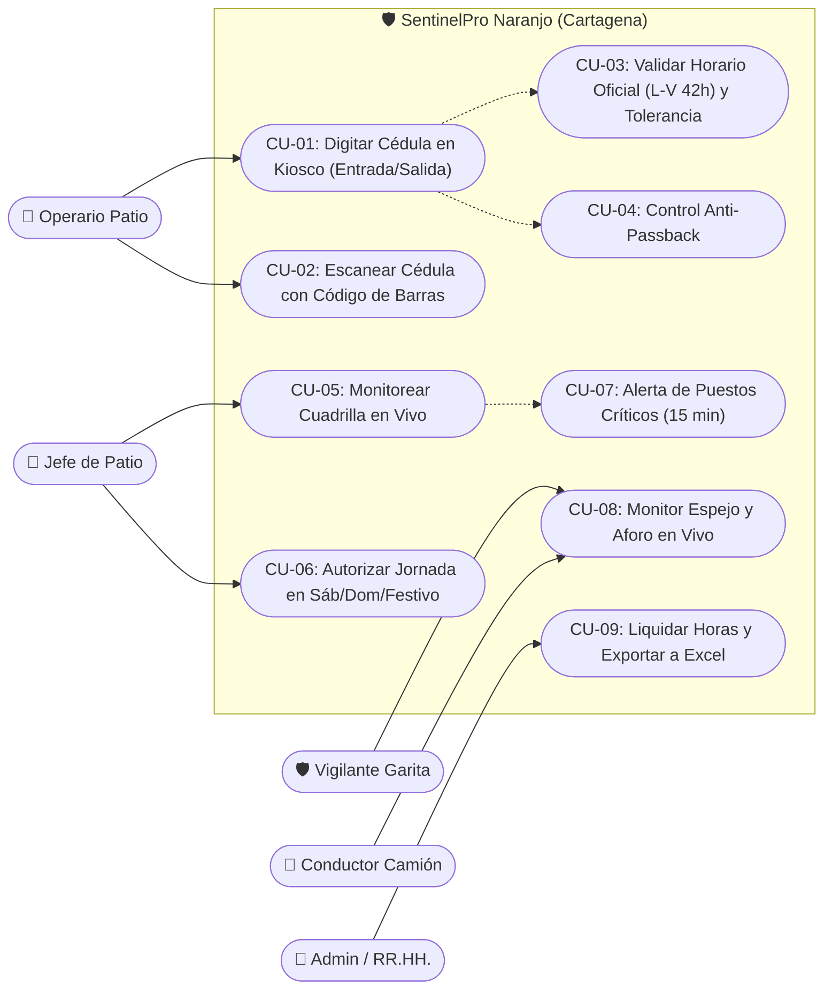
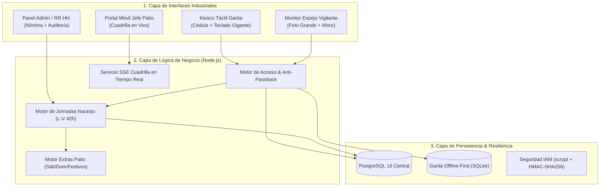
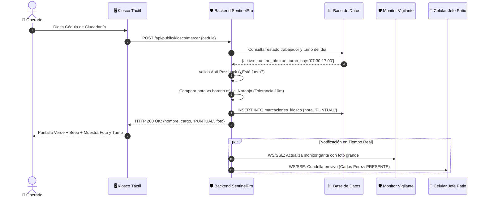
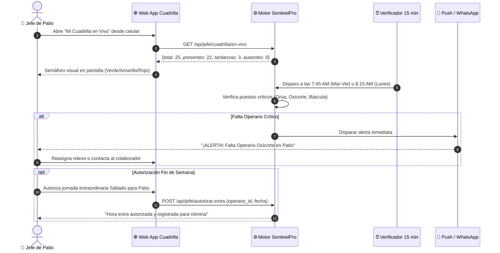
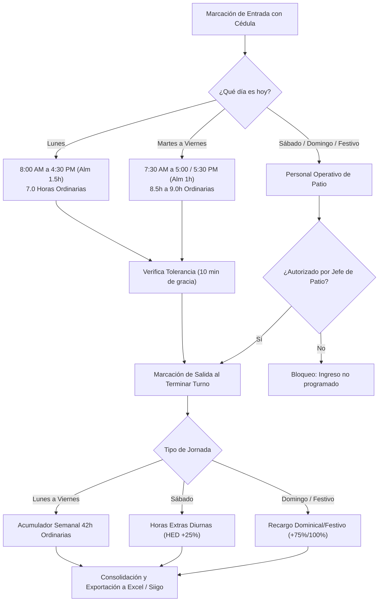
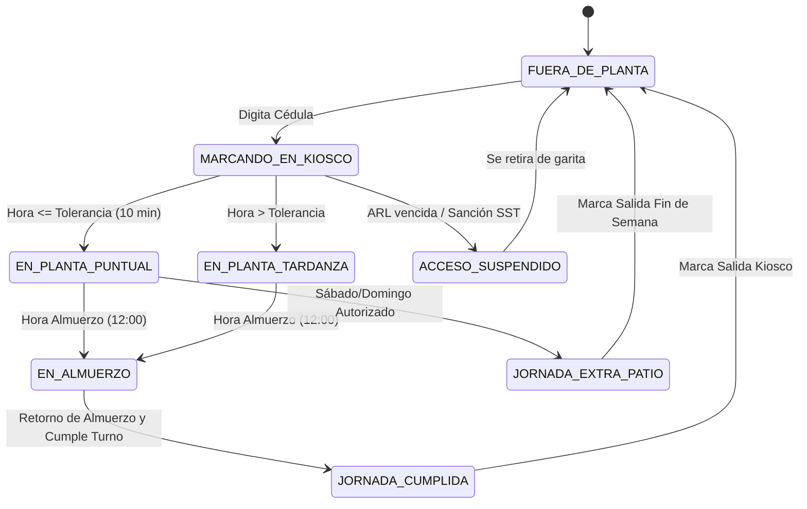
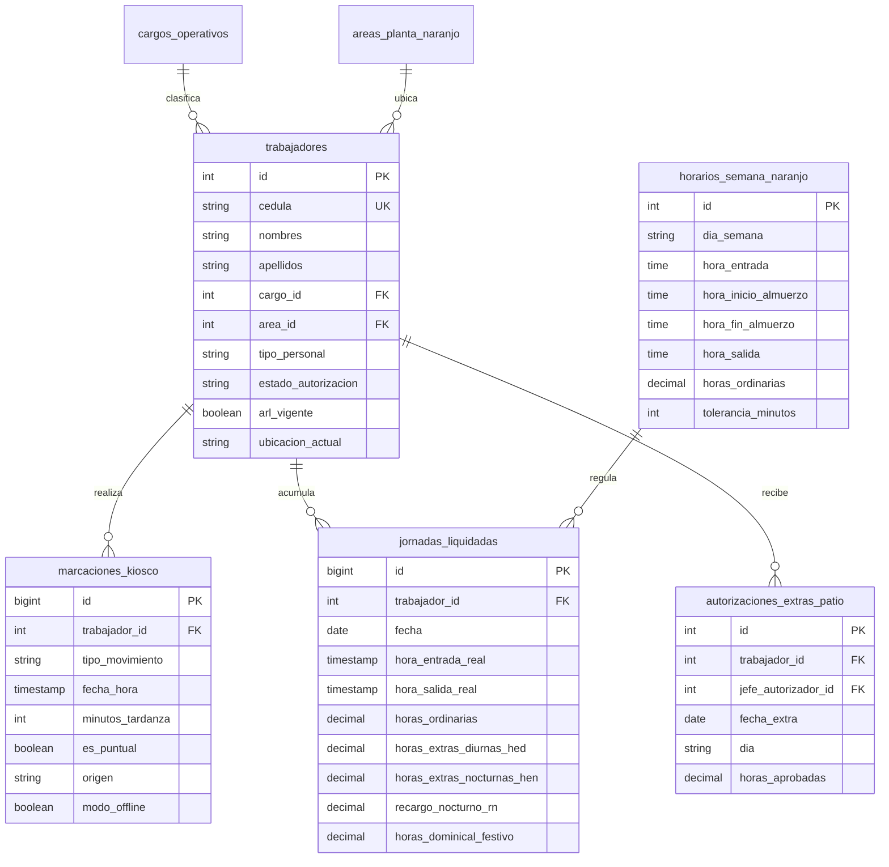

# 🛡️ Plan Maestro: Sistema Integral de Control de Acceso, Asistencia 42h y Portería Industrial
## Empresa: Recuperaciones Naranjo Recycling S.A.S. — Sede Cartagena de Indias (Bolívar, Colombia)

> **Documento Oficial de Arquitectura y Especificación Técnica**  
> **Sistema Base:** SentinelPro Access & IAM Enterprise Edition  
> **Horario Oficial Aplicado:** 42 Horas Semanales (Lunes a Viernes) según Memorando Corporativo y Ley 2101 / CST  
> **Ubicación:** Planta Industrial / Patio de Metales, Desintegración Vehicular y Portería Principal, Cartagena de Indias  
> **Documento Word Oficial (.docx):** [`Plan_Sistema_Acceso_Recuperaciones_Naranjo_Cartagena.docx`](../Plan_Sistema_Acceso_Recuperaciones_Naranjo_Cartagena.docx) *(Incluye los 8 diagramas en alta resolución incrustados)*

---

## 📑 Índice General
1. [Visión General y Contexto Operativo en Cartagena](#1-visión-general-y-contexto-operativo-en-cartagena)
2. [Tabla Oficial de Horarios Laborales (L-V 42 Horas) y Régimen de Patio](#2-tabla-oficial-de-horarios-laborales-l-v-42-horas-y-régimen-de-patio)
3. [El Kiosco de Garita: Fichaje con Cédula para el Trabajador](#3-el-kiosco-de-garita-fichaje-con-cédula-para-el-trabajador)
4. [Portal en Vivo para el Jefe de Área / Supervisor de Patio](#4-portal-en-vivo-para-el-jefe-de-área--supervisor-de-patio)
5. [Motor de Liquidación de Nómina: Código Sustantivo del Trabajo (Colombia)](#5-motor-de-liquidación-de-nómina-código-sustantivo-del-trabajo-colombia)
6. [Consola del Vigilante de Portería y Control de Visitantes](#6-consola-del-vigilante-de-portería-y-control-de-visitantes)
7. [Resiliencia Industrial: Garita Offline-First ante Fallas de Red](#7-resiliencia-industrial-garita-offline-first-ante-fallas-de-red)
8. [Galería de Diagramas Técnicos Oficiales (PNG y Mermaid)](#8-galería-de-diagramas-técnicos-oficiales-png-y-mermaid)
9. [Cronograma de Implementación Propuesto (4 Semanas)](#9-cronograma-de-implementación-propuesto-4-semanas)

---

## 1. Visión General y Contexto Operativo en Cartagena

**Recuperaciones Naranjo Recycling S.A.S.** es una empresa con operaciones de alta exigencia en reciclaje de metales ferrosos y no ferrosos, oxicorte, desintegración vehicular y pesaje en báscula en Cartagena de Indias.

En un entorno industrial con calor tropical, tránsito constante de camiones de carga pesada y cuadrillas de operarios en patio, el control de acceso debe cumplir con tres pilares esenciales:
- **Agilidad Extrema en Garita:** El trabajador no puede perder tiempo haciendo filas; debe ingresar digitando su Cédula de Ciudadanía en una pantalla táctil o escaneándola en menos de 1 segundo.
- **Supervisión Inmediata para el Jefe:** El director de patio y los supervisores deben saber exactamente desde su teléfono o tablet quién llegó, quién está tarde y quién faltó, para organizar la operación sin demoras.
- **Exactitud para Nómina y SST:** Saber cuántas horas laboró cada colaborador, cálculo automático de recargos nocturnos, horas extras y festivos conforme al Código Sustantivo del Trabajo de Colombia, y control de aforo estricto para planes de emergencia y ARL.

---

## 2. Tabla Oficial de Horarios Laborales (L-V 42 Horas) y Régimen de Patio

Conforme al Memorando Oficial de la empresa, el horario laboral ordinario de **Lunes a Viernes** suma exactamente **42 Horas Semanales**, en concordancia con la Ley 2101 de 2021:

| Día de la Semana | Hora de Entrada | Inicio Almuerzo | Fin Almuerzo | Hora de Salida | Horas Ordinarias Netas |
| :--- | :---: | :---: | :---: | :---: | :---: |
| **Lunes** | 8:00 AM | 12:00 PM | 1:30 PM (1.5 h) | 4:30 PM | **7.0 Horas** |
| **Martes** | 7:30 AM | 12:00 PM | 1:00 PM (1.0 h) | 5:00 PM | **8.5 Horas** |
| **Miércoles** | 7:30 AM | 12:00 PM | 1:00 PM (1.0 h) | 5:30 PM | **9.0 Horas** |
| **Jueves** | 7:30 AM | 12:00 PM | 1:00 PM (1.0 h) | 5:30 PM | **9.0 Horas** |
| **Viernes** | 7:30 AM | 12:00 PM | 1:00 PM (1.0 h) | 5:00 PM | **8.5 Horas** |
| **Sábado** | *No Laboral (Admin)* | — | — | — | **Jornada Extra Patio (HED +25%)** |
| **Domingo / Festivo** | *No Laboral (Admin)* | — | — | — | **Jornada Extra Patio (Recargo +75%/100%)** |
| **TOTAL ORDINARIO** | — | — | — | — | **42.0 Horas Semanales** |

### Diferenciación Operativa: Personal de Patio vs Administración
1. **Personal Administrativo:** Labora de lunes a viernes (42 horas semanales). Sábados, domingos y festivos son días de descanso obligatorio remunerado.
2. **Personal Operativo de Patio:** Ocasionalmente trabaja sábados, domingos e incluso días festivos para atender operaciones portuarias, recepción de chatarra pesada o cortes urgentes:
   - **Sábados:** Al haberse completado las 42 horas ordinarias entre lunes y viernes, todo el tiempo laborado el sábado se liquida como **Horas Extras Diurnas (HED +25%)** o Nocturnas (HEN +75%).
   - **Domingos y Festivos:** Se liquidan con el **Recargo Dominical/Festivo de Ley (+75% a +100%)** más horas extras dominicales (HEDDF +100% / HENDF +150%), previa autorización formal del Jefe de Patio.

---

## 3. El Kiosco de Garita: Fichaje con Cédula para el Trabajador

- **Pantalla Numérica Gigante:** Teclado táctil en pantalla con teclas de 80x80 px para digitar cómodamente la Cédula de Ciudadanía con guantes.
- **Escaneo Opcional con Código de Barras:** Lector láser que escanea el código PDF417 de la cédula colombiana física o carnet en 300 ms sin necesidad de digitar.
- **Verificación Instantánea de Tolerancia:** Compara contra el horario oficial del día (Lunes 8:00 AM, Martes-Viernes 7:30 AM). Si llega dentro de los 10 minutos de gracia, registra `PUNTUAL`; si supera los 10 minutos, calcula los minutos exactos de tardanza.
- **Control Anti-Passback Estricto:** Si el operario ya ingresó a la planta y no ha registrado salida, el sistema bloquea una segunda entrada fraudulenta y le solicita marcar Salida.
- **Retroalimentación Visual y Sonora:** Pantalla verde con foto oficial y tono de aprobación para ingreso exitoso; pantalla roja con tono grave si tiene la credencial suspendida o si intenta una marcación inválida.
- **Registro de Salida:** Al finalizar el turno, vuelve a digitar su cédula; el sistema registra la `SALIDA` y le muestra:  
  `👋 ¡Buen descanso, Carlos! Salida registrada (05:04 PM) — Jornada: 8h 34min`.

---

## 4. Portal en Vivo para el Jefe de Área / Supervisor de Patio

- **Tablero "Mi Cuadrilla en Vivo":** Muestra en tiempo real desde el celular o tablet: Trabajadores asignados al área, Total presentes en planta, Total ausentes y Tardanzas acumuladas.
- **Semáforo Visual de Asistencia:**
  - 🟢 **Verde:** Presente y puntual.
  - 🟡 **Amarillo:** Llegó con tardanza (indica minutos).
  - 🔴 **Rojo:** Ausente sin justificar.
- **Alerta Automática a los 15 Minutos:** A las 7:45 AM (Mar-Vie) u 8:15 AM (Lunes), el sistema alerta al celular si falta un puesto crítico (Oxigenista, Chofer de Grúa, Báscula).
- **Autorización de Extras de Fin de Semana:** El jefe puede autorizar desde su celular la jornada de sábado, domingo o festivo de los operarios que se requieren en patio.
- **Historial de Asistencia y Puntualidad:** Consulta por trabajador de los últimos 30 días con gráficos de puntualidad, días laborados y horas acumuladas.

---

## 5. Motor de Liquidación de Nómina: Código Sustantivo del Trabajo (Colombia)

- **Horas Ordinarias (HOD):** Acumulación de hasta 42 horas semanales distribuidas de lunes a viernes según la tabla oficial.
- **Horas Extras Diurnas (HED +25%):** Horas laboradas que superen la jornada diaria oficial de lunes a viernes, o todo el tiempo laborado el sábado por personal de patio.
- **Horas Extras Nocturnas (HEN +75%):** Horas extras laboradas entre las 21:00 y las 06:00.
- **Recargo Nocturno (RN +35%):** Horas ordinarias laboradas dentro de la franja nocturna (21:00 a 06:00).
- **Horas Dominicales y Festivas (RDF +75%/100%):** Horas laboradas en domingos o días feriados por el personal operativo de patio, con opción de descanso compensatorio o pago.
- **Exportación a Software Contable:** Generación de archivo Excel (.xlsx) y CSV compatible con Siigo, World Office, Novasoft, Helisa o SAP.

---

## 6. Consola del Vigilante de Portería y Control de Visitantes

1. **Monitor Espejo:** Cuando un operario digita su cédula en el Kiosco, la pantalla del vigilante muestra la foto oficial en grande para cotejo visual.
2. **Control de Camiones y Proveedores de Chatarra:** Registro de transportistas, proveedores y contratistas con Cédula, Nombres, Empresa de Procedencia, Placa del Camión y asignación de gafete temporal.
3. **Contador de Aforo en Vivo de Planta:** Muestra en tiempo real cuántas personas (operarios + administrativos + visitantes) se encuentran adentro para planes de emergencia y auditorías SST/ARL.

---

## 7. Resiliencia Industrial: Garita Offline-First ante Fallas de Red

- **Base de Datos Local en el Kiosco (SQLite):** El terminal de garita almacena localmente una réplica cifrada de las cédulas autorizadas y turnos.
- **Marcación Continua en Modo Offline:** Si se interrumpe la conexión con el servidor central, el Kiosco pasa automáticamente a 'Modo Local' sin detener el flujo de ingreso.
- **Sincronización Automática:** Cuando se reanuda el enlace, los registros encolados con su hora exacta se sincronizan hacia la base central sin intervención humana.
- **Respaldo con UPS:** Autonomía de 4 horas de energía para garita ante apagones o fluctuaciones eléctricas.

---

## 8. Galería de Diagramas Técnicos Oficiales (PNG y Mermaid)

### 📊 Diagrama 01: Casos de Uso del Sistema de Acceso Naranjo
*(Archivo PNG: [`docs/diagramas_naranjo_png/01_Casos_De_Uso_Recuperaciones_Naranjo.png`](./diagramas_naranjo_png/01_Casos_De_Uso_Recuperaciones_Naranjo.png))*



---

### 🏛️ Diagrama 02: Arquitectura en Capas y Motor 42h
*(Archivo PNG: [`docs/diagramas_naranjo_png/02_Arquitectura_Capas_Y_Motor_42Horas.png`](./diagramas_naranjo_png/02_Arquitectura_Capas_Y_Motor_42Horas.png))*



---

### ⏱️ Diagrama 03: Secuencia — Fichaje en Kiosco con Cédula
*(Archivo PNG: [`docs/diagramas_naranjo_png/03_Secuencia_Fichaje_Kiosco_Cedula.png`](./diagramas_naranjo_png/03_Secuencia_Fichaje_Kiosco_Cedula.png))*



---

### 🚨 Diagrama 04: Monitoreo de Cuadrilla y Alertas de Puestos Críticos
*(Archivo PNG: [`docs/diagramas_naranjo_png/04_Secuencia_Monitoreo_Cuadrilla_Jefe_Patio.png`](./diagramas_naranjo_png/04_Secuencia_Monitoreo_Cuadrilla_Jefe_Patio.png))*



---

### 📈 Diagrama 05: Flujo de Liquidación 42h y Recargos de Patio
*(Archivo PNG: [`docs/diagramas_naranjo_png/05_Flujo_Liquidacion_Jornadas_Y_Horas_Extras.png`](./diagramas_naranjo_png/05_Flujo_Liquidacion_Jornadas_Y_Horas_Extras.png))*



---

### 🔄 Diagrama 06: Máquina de Estados del Trabajador
*(Archivo PNG: [`docs/diagramas_naranjo_png/06_Estados_Trabajador_Y_Ciclo_Turno.png`](./diagramas_naranjo_png/06_Estados_Trabajador_Y_Ciclo_Turno.png))*



---

### 🗄️ Diagrama 07: Modelo Entidad-Relación (ERD) Naranjo
*(Archivo PNG: [`docs/diagramas_naranjo_png/07_Modelo_Entidad_Relacion_ERD_Naranjo.png`](./diagramas_naranjo_png/07_Modelo_Entidad_Relacion_ERD_Naranjo.png))*



---

### 🌐 Diagrama 08: Despliegue Físico de Hardware y Red
*(Archivo PNG: [`docs/diagramas_naranjo_png/08_Despliegue_Hardware_Red_Planta_Cartagena.png`](./diagramas_naranjo_png/08_Despliegue_Hardware_Red_Planta_Cartagena.png))*

```mermaid
flowchart TD
    subgraph Garita_Peatonal["🚪 Zona 1: Portería Peatonal (Garita Principal)"]
        Totem["Tótem Kiosco Táctil Industrial 19\"\n(Teclado Numérico Cédula)"]
        Scanner["Lector Láser Código Barras PDF417"]
        UPS["UPS Online 2 KVA (4h autonomía)"]
        Camara["Cámara IP Seguridad Facial"]
    end

    subgraph Garita_Vehicular["🚛 Zona 2: Garita Vehicular / Báscula"]
        PCVigilante["PC Vigilante Monitor 24\"\n(Monitor Espejo + Aforo)"]
        Bascula["Interfaz Báscula Pesaje Chatarra"]
        Barrera["Talanquera Camiones Pesados"]
        LPR["Cámaras LPR Lectura Placas"]
    end

    subgraph Servidor_Edge["⚙️ Zona 3: Servidor Local y Nube"]
        MiniSrv["Servidor Edge en Rack Garita\n(Node.js + SQLite Offline)"]
        CloudDB[("PostgreSQL 16 Central / Cloud\n(Copia de Seguridad y API)")]
    end

    subgraph Patio_Oficinas["🏗️ Zona 4: Patio y Administración"]
        Tablets["Tablets Jefes de Patio\n(WiFi Industrial 5GHz)"]
        AdminPC["PCs Gestión Humana y Nómina\n(Exportador Excel / Siigo)"]
    end

    Totem <-->|"Ethernet Gigabit"| MiniSrv
    PCVigilante <-->|"Ethernet Gigabit"| MiniSrv
    MiniSrv <-->|"Fibra Óptica / LAN"| CloudDB
    Tablets <-->|"WiFi Industrial"| MiniSrv
    AdminPC <-->|"Red Corporativa"| CloudDB
```

---

## 9. Cronograma de Implementación Propuesto (4 Semanas)

| Semana / Fase | Hitos de Desarrollo e Implementación | Entregables Tangibles |
| :---: | :--- | :--- |
| **Semana 1** | **Configuración Horario 42h y Padrón Naranjo**<br>• Parametrización del horario oficial (Lunes 8:00–16:30, Mar/Vie 7:30–17:00, Mié/Jue 7:30–17:30).<br>• Carga de Cédulas de Ciudadanía y cargos de Patio y Administración. | Base de datos relacional parametrizada con el personal y horarios oficiales de Naranjo. |
| **Semana 2** | **Kiosco Táctil con Cédula de Ciudadanía**<br>• Teclado numérico gigante en pantalla para operarios con guantes.<br>• Escaneo láser de cédula colombiana física (PDF417).<br>• Cálculo de tolerancia (10 min) y control Anti-Passback. | Terminal Kiosco táctil operativo en garita peatonal para pruebas con operarios. |
| **Semana 3** | **Portal de Jefes de Patio y Motor de Nómina**<br>• Tablero 'Mi Cuadrilla en Vivo' para supervisores de patio.<br>• Alertas de puestos críticos a 15 min.<br>• Autorización de extras de sábados/domingos y exportador a Excel. | Dashboard de supervisores activo y pre-liquidación de horas ordinarias/extras lista. |
| **Semana 4** | **Pruebas en Campo y Despliegue en Garita**<br>• Instalación en la portería industrial de Cartagena con respaldo UPS.<br>• Capacitación de 1 hora al personal de vigilancia y supervisores.<br>• Marcha blanca y salida a producción oficial. | Planta industrial de Cartagena operando al 100% con control de acceso digitalizado. |
