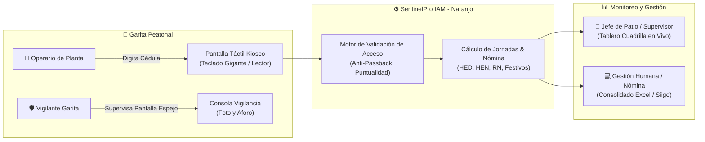
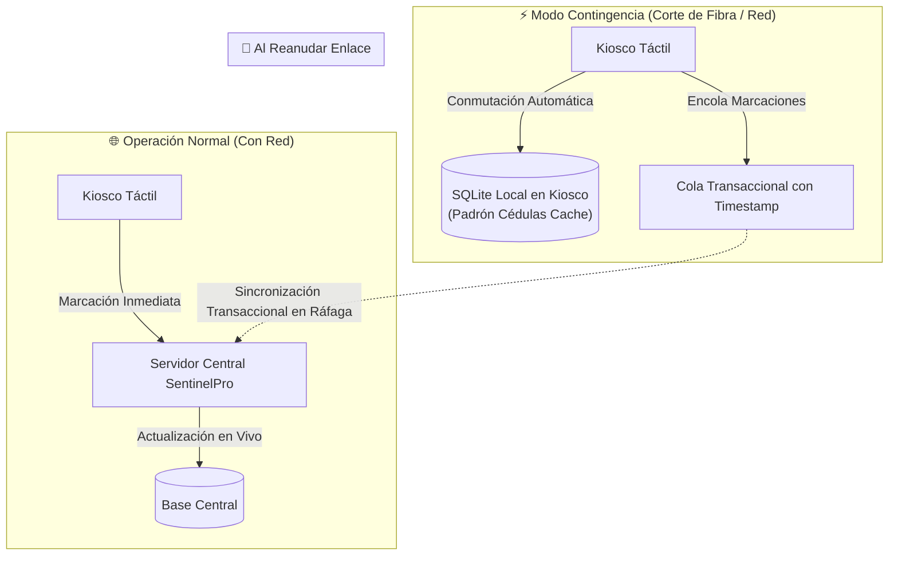

# 🛡️ Plan Maestro: Sistema Integral de Control de Acceso, Asistencia y Portería Industrial
## Empresa: Recuperaciones Naranjo S.A.S. — Sede Cartagena de Indias (Bolívar, Colombia)

> **Documento Estratégico y de Especificación Técnica**  
> **Sistema Base:** SentinelPro Access & IAM Enterprise Edition  
> **Ubicación de Aplicación:** Planta Industrial / Patio de Metales, Desintegración Vehicular y Portería Principal, Cartagena de Indias  
> **Fecha de Emisión:** Octubre 2026  
> **Documento Word Ejecutivo (.docx):** [`Plan_Sistema_Acceso_Recuperaciones_Naranjo_Cartagena.docx`](../Plan_Sistema_Acceso_Recuperaciones_Naranjo_Cartagena.docx)

---

## 📑 Índice General
1. [Visión General y Contexto Operativo en Cartagena](#1-visión-general-y-contexto-operativo-en-cartagena)
2. [El Kiosco de Garita: Fichaje con Cédula para el Trabajador](#2-el-kiosco-de-garita-fichaje-con-cédula-para-el-trabajador)
3. [Portal en Vivo para el Jefe de Área / Supervisor de Patio](#3-portal-en-vivo-para-el-jefe-de-área--supervisor-de-patio)
4. [Panel del Administrador y Gestión Humana (Nómina Colombia)](#4-panel-del-administrador-y-gestión-humana-nómina-colombia)
5. [Consola del Vigilante de Portería y Control de Visitantes](#5-consola-del-vigilante-de-portería-y-control-de-visitantes)
6. [Resiliencia Industrial: Garita Offline-First ante Fallas de Red](#6-resiliencia-industrial-garita-offline-first-ante-fallas-de-red)
7. [Cronograma de Implementación Propuesto (4 Semanas)](#7-cronograma-de-implementación-propuesto-4-semanas)
8. [Matriz de Decisión y Próximos Pasos](#8-matriz-de-decisión-y-próximos-pasos)

---

## 1. Visión General y Contexto Operativo en Cartagena

**Recuperaciones Naranjo S.A.S.** es una empresa con operaciones de alta exigencia en reciclaje de metales, recuperación industrial, oxicorte, desintegración vehicular y pesaje en báscula en Cartagena de Indias.

En un entorno industrial con calor tropical, tránsito constante de camiones de carga pesada y cuadrillas de operarios en patio, el control de acceso debe cumplir con tres pilares esenciales:
- **Agilidad Extrema en Garita:** El trabajador no puede perder tiempo haciendo filas; debe ingresar digitando su Cédula de Ciudadanía en una pantalla táctil o escaneándola en menos de 1 segundo.
- **Supervisión Inmediata para el Jefe:** El director de patio y los supervisores deben saber exactamente desde su teléfono o tablet quién llegó, quién está tarde y quién faltó, para organizar la operación sin demoras.
- **Exactitud para Nómina y SST:** Saber cuántas horas laboró cada colaborador, cálculo automático de recargos nocturnos, horas extras y festivos conforme al Código Sustantivo del Trabajo de Colombia, y control de aforo estricto para planes de emergencia y ARL.

---

## 2. El Kiosco de Garita: Fichaje con Cédula para el Trabajador

### 2.1. Características del Terminal Táctil
- **Pantalla Táctil Industrial All-in-One (15" a 21"):** Empotrada en pared o pedestal metálico en la portería peatonal.
- **Teclado Numérico Gigante en Pantalla:** Botones de 80x80 píxeles, con alto contraste (números claros sobre fondo oscuro) para uso cómodo con o sin guantes de protección.
- **Lectura Opcional con Escáner de Código de Barras:** El operario puede aproximar el código de barras (PDF417) al reverso de su cédula colombiana o su carnet de la empresa para fichar en 300 milisegundos sin digitar.

### 2.2. Flujo de Marcación de Entrada (Check-In)
1. El operario digita su número de Cédula de Ciudadanía y presiona **"INGRESAR"**.
2. **Validación Instantánea:**
   - Comprueba que la credencial esté `ACTIVA` (no suspendida por SST o permisos vencidos).
   - Comprueba el turno asignado (ej. Mañana 06:00 a 14:00).
   - Aplica el margen de tolerancia (ej. 10 minutos de gracia).
   - Control **Anti-Passback:** Si el operario ya ingresó y no ha salido, el sistema rechaza una nueva entrada y le indica que debe marcar Salida.
3. **Respuesta en Pantalla y Audio:**
   - **Luz Verde + Tono de Aprobación:**
     - Muestra foto del operario, nombre completo, cargo (*ej. Operario de Oxicorte*), área (*Patio de Chatarra*), hora exacta y estatus:  
       `✅ INGRESO REGISTRADO — PUNTUAL (05:54 AM)` o `⚠️ INGRESO REGISTRADO — TARDANZA DE 14 MIN`.

### 2.3. Flujo de Marcación de Salida (Check-Out)
1. Al terminar la jornada, el operario digita nuevamente su cédula.
2. El sistema detecta que está dentro de planta y conmuta a registro de **SALIDA**.
3. **Cálculo de Tiempo Laborado:**
   - Calcula el tiempo total de permanencia en planta (horas y minutos).
   - Muestra mensaje de despedida:  
     `👋 ¡Buen descanso, Carlos! Salida registrada (02:10 PM) — Jornada: 8 horas 16 minutos`.
   - Se libera el estado del trabajador a `FUERA_DE_PLANTA`.

---

## 3. Portal en Vivo para el Jefe de Área / Supervisor de Patio

El jefe de patio o supervisor de área necesita información en tiempo real para tomar decisiones operativas. Tendrá acceso a una vista móvil y web optimizada:

| Módulo del Jefe | Función Operativa | Impacto Práctico en Planta |
| :--- | :--- | :--- |
| **Tablero "Mi Cuadrilla en Vivo"** | Lista en tiempo real de todos los trabajadores bajo su cargo, indicando quién ya entró, quién está en camino y quién no ha llegado. | Saber a las 06:15 AM si el equipo de oxicorte o desintegración está completo para encender maquinaria. |
| **Semáforo Visual de Asistencia** | **Verde:** Presente y puntual. **Amarillo:** Llegó con retraso (muestra minutos de tardanza). **Rojo:** Ausente sin reporte. | Diagnóstico visual en 5 segundos sin tener que pasar lista con papel y lápiz. |
| **Alertas de Puestos Críticos** | Notificación al celular si un cargo indispensable (ej. Operador de Báscula o Grúa) no ha marcado 15 min después del inicio del turno. | Tiempo suficiente para llamar a un relevo o reasignar un operario certificado de turno previo. |
| **Autorización de Horas Extras** | El jefe puede autorizar desde su celular la prolongación de jornada de un operario que debe quedarse a terminar un cargue. | Valida que solo se paguen horas extras debidamente justificadas en campo. |
| **Histórico de Rendimiento** | Consulta gráfica de asistencia y puntualidad de los últimos 30 días por trabajador. | Datos objetivos para reconocimientos, bonos de puntualidad o llamados de atención de Gestión Humana. |

---

## 4. Panel del Administrador y Gestión Humana (Nómina Colombia)

El Administrador General y el equipo de Gestión Humana disponen de todas las herramientas para la administración laboral:

### 4.1. Configuración de Turnos Industriales
- **Turno Mañana / Rotativo 1:** 06:00 a 14:00 (8 horas continuas).
- **Turno Tarde / Rotativo 2:** 14:00 a 22:00.
- **Turno Noche / Rotativo 3:** 22:00 a 06:00.
- **Turno Administrativo:** 07:30 a 17:30 (con 1 hora de descanso/almuerzo).
- **Margen de Tolerancia:** Parametrizable (ej. 10 minutos de gracia antes de contabilizar tardanza).

### 4.2. Motor de Pre-Liquidación Laboral (CST Colombia)
El sistema clasifica automáticamente cada hora trabajada conforme a la normatividad laboral colombiana:
- **Horas Ordinarias Diurnas (HOD):** Jornada legal ordinaria entre 06:00 y 21:00.
- **Recargo Nocturno (RN +35%):** Horas ordinarias laboradas entre las 21:00 y las 06:00 del día siguiente.
- **Horas Extras Diurnas (HED +25%):** Horas laboradas por encima de la jornada máxima legal en horario diurno.
- **Horas Extras Nocturnas (HEN +75%):** Horas extras laboradas en horario nocturno (21:00 a 06:00).
- **Horas Dominicales y Festivas:** Cálculo de recargos dominicales (75% / 100% según reforma progresiva) y extras dominicales.

### 4.3. Exportación para Software de Nómina
- Descarga directa en **Excel (.xlsx)** y **CSV** con el formato exacto requerido para cargar novedades en plataformas como **Siigo, World Office, Novasoft, Helisa o SAP**, ahorrando días de trabajo manual al departamento de nómina.

### 4.4. Gestión de Novedades y Auditoría
- Registro de incapacidades médicas expedidas por la EPS, permisos remunerados, calamidad doméstica y suspensiones disciplinarias.
- Bitácora inmutable: Registro de qué usuario modificó un turno, autorizó una marcación manual o suspendió a un empleado.

---

## 5. Consola del Vigilante de Portería y Control de Visitantes

El vigilante en garita dispone de un monitor de apoyo que trabaja de forma sincronizada con el Kiosco táctil:
1. **Monitor Espejo:** Cuando un operario digita su cédula en el Kiosco, la pantalla del vigilante muestra la foto oficial en alta resolución para corroborar la identidad y evitar suplantaciones (*"fichajes por compañeros"*).
2. **Control de Visitantes y Proveedores de Chatarra:**
   - Registro de transportistas, proveedores y contratistas con Cédula, Nombres, Empresa de Procedencia (*ej. Taller X, Transportes Cartagena*), Placa del Camión y Motivo.
   - Asignación de gafete temporal numerado (*ej. VIS-01*).
   - Fichaje obligatorio de salida con devolución del gafete.
3. **Contador de Aforo en Vivo de Planta:**
   - Muestra en números grandes cuántas personas en total están dentro de Recuperaciones Naranjo (Personal propio + Contratistas + Visitantes).
   - Esencial para el Plan de Evacuación en Emergencias y requerimientos de Bomberos de Cartagena y Cardique.

---

## 6. Resiliencia Industrial: Garita Offline-First ante Fallas de Red

- **Operación Continua:** Si se interrumpe la red en la zona industrial, la pantalla de garita pasa a *Modo Autónomo*; los trabajadores siguen digitando su cédula y el acceso se concede normalmente.
- **Sincronización Cero-Pérdidas:** Cuando se reanuda la red, el Kiosco envía los registros acumulados con su hora exacta y la base central se actualiza automáticamente.
- **Respaldo Eléctrico con UPS:** Alimentación ininterrumpida de al menos 4 horas para mantener la portería funcionando ante cortes eléctricos.

---

## 7. Cronograma de Implementación Propuesto (4 Semanas)

| Semana | Hito de Implementación | Entregables Clave |
| :---: | :--- | :--- |
| **Semana 1** | **Personalización de Marca y Carga de Padrón** | Identidad visual Recuperaciones Naranjo, sedes en Cartagena, carga de base de datos de trabajadores con cédulas colombianas y turnos de planta. |
| **Semana 2** | **Kiosco Táctil de Garita con Cédula** | Interfaz táctil con teclado numérico gigante, soporte de escáner de código de barras, retroalimentación acústica y control anti-passback. |
| **Semana 3** | **Portal de Jefes de Patio y Motor de Nómina** | Tablero en vivo "Mi Cuadrilla" para supervisores, liquidación de horas diurnas/nocturnas/festivas y exportador a Excel para nómina. |
| **Semana 4** | **Pruebas en Campo y Salida a Producción** | Instalación del terminal en la garita de Cartagena, capacitación de 1 hora al personal de vigilancia y puesta en marcha oficial. |

---

## 8. Matriz de Decisión y Próximos Pasos

Para iniciar la adaptación inmediata del sistema en el código, los siguientes pasos son los recomendados:
1. **Paso 1:** Actualizar los datos maestros del sistema en `server/presets.js` y `database/schema.sql` con los departamentos y cargos reales de **Recuperaciones Naranjo S.A.S. (Cartagena)**.
2. **Paso 2:** Modificar la vista pública en `public/index.html` y `public/app.js` para incorporar el **Teclado Numérico Gigante de Cédula** en la pantalla del Kiosco.
3. **Paso 3:** Incorporar la pestaña y vista exclusiva para **Jefes de Área ("Mi Cuadrilla en Vivo")** y el motor de cálculo de horas de nómina según la legislación colombiana.
4. **Paso 4:** Generar y desplegar los cambios en el repositorio de GitHub.
